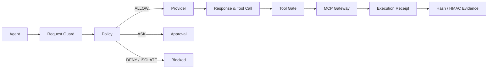

<div align="center">
  
  <h1>AgentBulwark · 智垒</h1>
  <p><strong>AI Agent 防火墙</strong></p>
  <p>让每一次模型请求、上下文输入、输出和工具行动，都先经过可验证的运行时边界。</p>
  <p>
    <a href="https://github.com/Chengxiaoyu1119/AgentBulwark/actions/workflows/quality.yml"></a>
    <a href="https://www.python.org/"></a>
    <a href="https://nodejs.org/"></a>
    <a href="https://modelcontextprotocol.io/"></a>
  </p>
  <p>
    <a href="docs/product/产品定位.md">产品定位</a> ·
    <a href="docs/engineering/安全边界.md">安全边界</a> ·
    <a href="AGENTS.md">协作规范</a>
  </p>
</div>

> **一句话**：AgentBulwark 是一个本地优先的 AI Agent Firewall。它把“模型想做什么”与“系统实际做了什么”放进同一条可追踪链路。

## 先看这里

| 你想做什么 | 从这里开始 |
| --- | --- |
| 5 分钟启动本地防火墙 | [快速开始](#快速开始) |
| 接入 OpenAI 兼容模型或 MCP | [接入 Agent](#接入-agent) |
| 理解策略、审批和证据 | [一次行动如何被证明](#一次行动如何被证明) |
| 判断项目是否适合你的团队 | [适用场景](#适用场景) 和 [当前状态](#当前状态) |
| 参与代码或文档 | [协作规范](AGENTS.md) |

## 防护链路



## 解决什么问题

普通 API 网关通常只判断请求能否到达服务，文本过滤器也只能判断一段内容像不像风险。AgentBulwark 继续向后走到 **模型输出、工具参数和真实执行**：策略决定行动，MCP 闸门决定能否产生副作用，执行回执和证据链记录最终事实。

| 防护层 | 观察对象 | 失败时的默认结果 |
| --- | --- | --- |
| 请求层 | 提示、外部上下文、身份、会话 | 不访问 Provider |
| 模型层 | 输出、工具定义、Tool Call | 不进入工具闸门 |
| 行动层 | Agent、Session、Schema、目标、审批 | `DENY` 或 `ISOLATE` |
| 证据层 | Trace、Hash、HMAC、执行回执 | 证据错误时拒绝执行 |

## 能力矩阵

- **OpenAI 兼容网关**：`/v1/chat/completions` 支持流式与非流式；`/v1/responses` 提供非流式入口。
- **MCP Gateway**：支持 stdio 与 Streamable HTTP，按 Agent + Session 隔离会话。
- **策略闸门**：工具注册、Schema、目标、权限和策略冲突按拒绝优先处理。
- **一次性审批**：审批绑定参数 Hash、策略版本、Agent、Session、目标和有效期，修改或重复消费立即失效。
- **可验证回执**：请求/响应 Hash、HMAC 审计链和服务端回执引用同一请求链。
- **本地控制台**：在防护、事件和设置页面查看实时行动、审批、执行状态和证据。

## 一次行动如何被证明

一次真实 Tool Call 至少经过以下步骤：

1. 网关为请求分配链路标识，并计算输入 Hash。
2. 输入和外部上下文先接受风险检查；失败不会触达 Provider。
3. Provider 通过固定主机、协议、端口和路径的出口访问。
4. 模型响应被标准化；未知工具、污染定义或畸形参数不能继续传播。
5. 策略返回 `ALLOW`、`DENY`、`ASK` 或 `ISOLATE`；需要审批时绑定精确参数 Hash、身份和有效期。
6. 只有通过 MCP 会话、工具注册、Schema、目标和权限检查的行动才会执行。
7. 服务端写入执行回执，并把 Trace、Hash、HMAC 和回执串成可离线验证的证据链。

<details>
<summary>一个审批行动的脱敏状态示例</summary>

```json
{
  "decision": "ASK",
  "source_status": "correlated",
  "evidence_status": "pending",
  "next": "operator approval"
}
```

示例只展示状态语义，不代表固定 API 响应；未经密码学关联的来源只能标记为 `correlated` 或 `unknown`。
</details>

## 适用场景

| 团队 | 需要解决的事情 | AgentBulwark 的切入点 |
| --- | --- | --- |
| AI 应用团队 | Agent 能调用内部工具，但权限和副作用不可见 | Agent + Session + Tool Gate |
| MCP 使用者 | 第三方 Server 工具定义和目标不稳定 | 注册、Schema、目标和会话隔离 |
| 私有/国产模型团队 | 不希望凭证和请求散落在客户端 | 固定 Provider 出口和后端凭证管理 |
| 安全评审团队 | 需要说明一次行动为什么被放行或阻断 | Trace、审批、回执和离线证据 |

## 快速开始

要求：Node.js 22+、Python 3.11+。项目是单机本地运行，不需要 Docker。

```powershell
git clone https://github.com/Chengxiaoyu1119/AgentBulwark.git
cd AgentBulwark
npm run install:all
Copy-Item .env.example .env
npm run dev
```

打开 [http://127.0.0.1:8012](http://127.0.0.1:8012)。服务默认只监听本机回环地址，Provider 密钥和 MCP 凭证只由后端读取。

### 运行检查

```powershell
Invoke-RestMethod http://127.0.0.1:8012/api/public/status
```

## 接入 Agent

将 Agent 的 OpenAI Base URL 指向 `http://127.0.0.1:8012/v1`，再在后端环境中登记 Provider 和 MCP 配置。核心入口：

| 方法 | 路径 | 用途 |
| --- | --- | --- |
| `POST` | `/v1/chat/completions` | OpenAI Chat Completions |
| `POST` | `/v1/responses` | OpenAI Responses（非流式） |
| `POST` | `/api/mcp` | MCP 初始化、发现和工具调用 |
| `GET` | `/api/overview` | 控制台总览数据 |
| `GET` | `/api/approvals` | 待处理审批 |
| `GET` | `/api/gateway/traces` | 请求与策略 Trace |
| `POST` | `/api/gateway/tool_calls/{audit_id}/execute` | 服务端托管的已审计工具执行 |
| `GET` | `/api/runtime/executions` | 执行回执 |
| `GET` | `/api/evidence/{evidence_id}` | 脱敏证据详情 |
| `POST` | `/api/evidence/{evidence_id}/verify` | Hash/HMAC 与回执核验 |

## 质量门禁

```powershell
npm run verify
npm run verify:live:fixture
```

`verify:live:fixture` 使用仓库内真实 HTTP Provider 与 MCP stdio 子进程完成确定性闭环，不改写正式运行数据。`verify:live` 默认不访问外部服务；只有显式设置 `AGENT_SUPERVISOR_LIVE_SMOKE=true` 才会运行外部 Provider 烟测。

## 控制台

本地控制台聚焦三个运行任务：

- **防护**：查看服务状态、策略模式和最近行动。
- **事件**：按请求链查看阻断、审批、工具调用和执行结果。
- **设置**：管理 Provider、MCP、Agent、会话和凭证引用。

## 当前状态

| 状态 | 范围 |
| --- | --- |
| 已实现 | OpenAI/MCP 网关、四态策略、一次性审批、执行回执、Hash/HMAC 证据、本地控制台 |
| 持续验证 | 外部 Provider/MCP 兼容性、跨平台安装和真实团队试点 |
| 明确不在当前范围 | 攻击实验室、任意代码执行、Docker 沙箱、DLP、多租户和 Kubernetes |

项目不会把内部夹具、演示数据或模型分类结果当作生产闭环证据。

## 文档地图

| 入口 | 内容 |
| --- | --- |
| [产品定位](docs/product/产品定位.md) | 用户、能力边界和可信度口径 |
| [安全边界](docs/engineering/安全边界.md) | 运行、策略、凭证和证据约束 |
| [本地开发](docs/engineering/本地开发.md) | 安装、启动、配置和故障排查 |
| [研究与决策](docs/research/大模型防火墙研究证据与产品决策.md) | 产品方向和技术依据 |
| [协作指南](AGENTS.md) | 目录边界、工程不变量和代理协作 |

## 仓库结构

```text
apps/api/agent_supervisor/  FastAPI 服务与运行内核
apps/api/tests/             后端测试、协议夹具和闭环验证
apps/console/               React + Vite 控制台
docs/                       产品、工程和研究文档
scripts/                    启动、维护和质量检查脚本
```

## 当前边界

AgentBulwark 是 AI Agent 运行时防火墙，不是攻击实验室、工具目录、任意代码执行器、Docker 沙箱或多租户平台。文本检测只负责输入、上下文和输出检查，最终执行边界由身份、策略、Schema 和 MCP 闸门共同决定。
