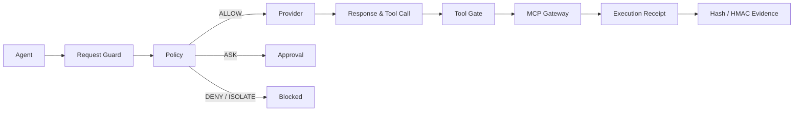

<div align="center">
  
  <h1>AgentBulwark · 智垒</h1>
  <p><strong>AI Agent 防火墙</strong></p>
  <p>把模型请求、外部上下文、输出和工具调用放进一个可观测、可阻断、可验证的运行时边界。</p>
  <p>
    <a href="https://github.com/Chengxiaoyu1119/AgentBulwark/actions/workflows/quality.yml"></a>
    <a href="https://github.com/Chengxiaoyu1119/AgentBulwark/blob/main/LICENSE"></a>
    <a href="https://www.python.org/"></a>
    <a href="https://nodejs.org/"></a>
    <a href="https://modelcontextprotocol.io/"></a>
  </p>
  <p>
    <a href="README_EN.md">English</a> ·
    <a href="docs/product/产品定位.md">产品定位</a> ·
    <a href="docs/engineering/安全边界.md">安全边界</a> ·
    <a href="CONTRIBUTING.md">参与贡献</a>
  </p>
</div>

> **一句话**：AgentBulwark 是一个本地优先的 AI Agent Firewall，让每一次模型请求和工具行动都先经过策略，再抵达真实 Provider 或 MCP。

## 防护链路



## 为什么是 AgentBulwark

传统 API 网关主要保护请求能否到达服务；AgentBulwark 继续向后走到 **模型输出、工具参数和真实执行**，把“模型想做什么”和“系统实际做了什么”放在同一条可追踪链路里。

| 层 | 处理内容 | 结果 |
| --- | --- | --- |
| 请求层 | 提示、外部上下文、请求身份和会话 | Provider 前阻断高风险输入 |
| 模型层 | 输出、工具定义和 Tool Call 标准化 | 不让未知或污染的行动继续传播 |
| 行动层 | Agent、Session、Schema、目标、策略和审批 | `ALLOW` · `DENY` · `ASK` · `ISOLATE` |
| 证据层 | Trace、Hash、HMAC、执行回执 | 离线验证每一次处置结果 |

## 能力矩阵

- **OpenAI 兼容网关**：`/v1/chat/completions` 支持流式与非流式；`/v1/responses` 提供非流式入口。
- **MCP Gateway**：支持 stdio 与 Streamable HTTP，按 Agent + Session 隔离会话。
- **策略闸门**：工具注册、Schema、目标、权限和策略冲突按拒绝优先处理。
- **一次性审批**：审批绑定参数 Hash、策略版本、Agent、Session、目标和有效期，重复消费自动失效。
- **可验证回执**：请求/响应 Hash、HMAC 审计链和服务端回执引用同一请求链。
- **本地控制台**：在防护、事件和设置页面查看实时状态、审批和证据。

## 快速开始

要求：Node.js 22+、Python 3.11+。项目是单机本地运行，不需要 Docker。

```powershell
git clone https://github.com/Chengxiaoyu1119/AgentBulwark.git
cd AgentBulwark
npm run install:all
Copy-Item .env.example .env
npm run dev
```

打开 [http://127.0.0.1:8012](http://127.0.0.1:8012)。服务默认只监听本机回环地址，Provider 密钥和 MCP 凭证只由后端读取。

## 接入 Agent

将 Agent 的 OpenAI Base URL 指向 `http://127.0.0.1:8012/v1`，再在后端环境中登记 Provider 和 MCP 配置。核心入口：

```text
POST /v1/chat/completions
POST /v1/responses
POST /api/mcp
GET  /api/overview
GET  /api/approvals
GET  /api/gateway/traces
GET  /api/runtime/executions
```

## 质量门禁

```powershell
npm run verify
npm run verify:live:fixture
```

`verify:live:fixture` 使用仓库内真实 HTTP Provider 与 MCP stdio 子进程完成确定性闭环，不改写正式运行数据。`verify:live` 默认不访问外部服务；只有显式设置 `AGENT_SUPERVISOR_LIVE_SMOKE=true` 才会运行外部 Provider 烟测。

## 文档地图

| 入口 | 内容 |
| --- | --- |
| [产品定位](docs/product/产品定位.md) | 用户、能力边界和可信度口径 |
| [安全边界](docs/engineering/安全边界.md) | 运行、策略、凭证和证据约束 |
| [研究与决策](docs/research/大模型防火墙研究证据与产品决策.md) | 产品方向和技术依据 |
| [贡献指南](CONTRIBUTING.md) | 本地开发、验证和 Pull Request |
| [安全策略](SECURITY.md) | 漏洞报告与敏感问题处理 |
| [协作指南](AGENTS.md) | 目录边界、工程不变量和代理协作 |

## 仓库结构

```text
apps/api/agent_supervisor/  FastAPI 服务与运行内核
apps/api/tests/             后端测试、协议夹具和闭环验证
apps/console/               React + Vite 控制台
docs/                       产品、工程和研究文档
legacy/                     只读历史资料，不进入生产入口
scripts/                    启动、维护和质量检查脚本
```

## 当前边界

AgentBulwark 是 AI Agent 运行时防火墙，不是攻击实验室、工具目录、任意代码执行器、Docker 沙箱或多租户平台。文本检测只负责输入、上下文和输出检查，最终执行边界由身份、策略、Schema 和 MCP 闸门共同决定。

## 许可证

Apache-2.0，详见 [LICENSE](LICENSE)。
