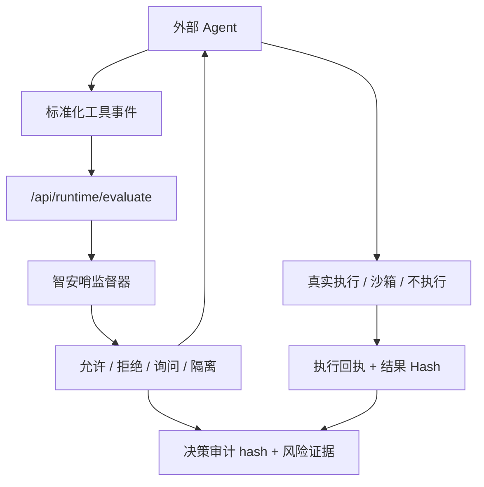

<p align="center">
  
</p>

<h1 align="center">智安哨 ZhiAn Sentinel</h1>

<p align="center">
  <strong>面向 LLM Agent、OpenAI 兼容 API 与 MCP 的 AI 安全网关</strong>
</p>

<p align="center">
  <strong>AI security gateway for LLM agents, OpenAI-compatible APIs, and MCP.</strong>
</p>

<p align="center">
  
  
  
  
  
</p>

<p align="center">
  <a href="#快速启动">快速启动</a> ·
  <a href="#接入方式">接入方式</a> ·
  <a href="./CONTRIBUTING.md">参与贡献</a> ·
  <a href="./SECURITY.md">安全上报</a> ·
  <a href="./CHANGELOG.md">变更日志</a> ·
  <a href="./README_EN.md">English</a>
</p>

---

## 项目概览

智安哨的最小问题是：一个 LLM 请求在到达模型供应商前、模型返回后和工具执行前，是否仍然满足调用者声明的安全契约。网关围绕这条信任边界做请求校验、不可信上下文检查、工具调用监督、输出过滤和审计留痕。

它面向大模型及智能体应用安全研究与防护，重点覆盖提示注入、模型越狱、数据泄露、工具调用劫持、记忆中毒、环境感知污染和滥用风险，并与 OWASP Agentic Security 风险清单对齐。

当前产品主线是 **LLM Agent / OpenAI 兼容 API / MCP 的安全网关**：请求进入模型供应商前检查不可信上下文，模型返回后检查文本与工具调用，真正执行前再由服务端执行器或接入适配器强制落实决策。网络资产扫描、通用流量平台、代码审计平台不属于本项目当前边界；评测实验只用于证明这条安全链路，不替代真实 Provider 和真实接入回执。

> [!IMPORTANT]
> 本项目通过受控实验环境和模拟业务数据复现风险。它的目标是研究和验证智能体安全防护，不会攻击真实外部系统。

```text
Agent 工具调用 -> 执行前监督 -> 允许 / 拒绝 / 询问 / 隔离
        -> 工具执行或停止 -> 执行回执 -> 事件审计与人工复核
```

<table>
  <tr>
    <td align="center"><strong>7</strong><br />攻击面</td>
    <td align="center"><strong>22</strong><br />攻击样本集</td>
    <td align="center"><strong>17</strong><br />防御策略</td>
    <td align="center"><strong>4</strong><br />处置决策</td>
    <td align="center"><strong>Agent</strong><br />通用接入</td>
    <td align="center"><strong>Hash+HMAC</strong><br />运行审计证据</td>
  </tr>
</table>

> 表格中的攻击面、样本和策略数量是研究/回归平面的目录统计，不是生产防护覆盖率，也不等于真实 Provider 已经执行了对应场景。生产能力只按当前 HTTP 网关、MCP 上游和服务端执行回执的可验证证据计算；历史盲测、冻结集和本地夹具不会替代真实接入证据。

### 运营平面与实验平面

默认启动的是运营网关，数据写入 `apps/api/runtime/operational`。实时流量、审计、告警、审批与执行回执只读取这套运营数据库；固定场景、历史报告和回归样本不会混入控制台指标。`/api/scenarios`、攻击链、红队和目标实验等路由默认关闭，只有在独立实验进程中显式设置 `AGENT_SUPERVISOR_LABS_ENABLED=true` 才会启用，并应同时指定独立的 `AGENT_SUPERVISOR_RUNTIME_DIR`。

## 核心能力

| 模块 | 能力 | 代码入口 |
|---|---|---|
| LLM API 网关 | 直接发送 Chat Completions 或 Responses 文本/函数调用请求，观察 Provider 前检查、Provider 响应和 tool call 处置证据 | `apps/console/src/pages/GatewayPanel.tsx` |
| 运行总览 | 展示服务、模型、风险事件、待确认回执和真实调用链状态 | `apps/console/src/pages/Dashboard.tsx` |
| 事件与复核 | 合并审计、告警、审批队列和执行回执，形成处置闭环 | `apps/console/src/pages/AuditLogPanel.tsx` |
| 网关验证（按需） | 以真实 Provider 请求建立无防护/有防护因果证据；固定样本和历史实验只作为回归材料，不参与生产请求 | `apps/console/src/components/settings/GatewayComparisonPanel.tsx` |
| 防护策略 | 管理工具调用策略、风险阈值和处置规则 | `apps/console/src/components/policy/PolicyCenter.tsx` |
| 行为监督器 | 对工具调用输出允许、拒绝、询问、隔离四类决策 | `apps/api/agent_supervisor/domains/governance/supervisor.py` |
| 审计与告警 | 记录工具参数、策略命中、风险分、异常分、审计 hash | `apps/api/agent_supervisor/domains/governance/integrity.py` |
| 评测与证据 | 评测不参与生产请求路径；真实模型盲测只有在 Provider 原始响应、策略快照、当前运行快照和执行回执均匹配时才算就绪 | `apps/api/agent_supervisor/domains/evaluations/` |
| 通用 Agent 接入 | HTTP 事件契约、AgentToolGuard、OpenAI Agents/LangChain/LangGraph 示例 | `apps/api/agent_supervisor/adapters/integrations/agent_integrations.py` |

## 系统架构


## 接入方式

智安哨可以作为外部 Agent 的工具调用防火墙。外部系统把即将执行的工具调用发给智安哨，智安哨返回是否允许、拒绝、询问或隔离。

| 接入方式 | 强制力 | 说明 |
|---|---|---|
| MCP Gateway | **强制式** | Agent 连接 Gateway（`POST /api/mcp`），Gateway 代理真实 MCP Server（stdio），所有 `tools/call` 必须经过监督器，拒绝/隔离/询问时不转发上游 |
| OpenAI 兼容代理 | **输入与工具调用双阶段阻断** | `POST /v1/chat/completions` 与 `POST /v1/responses` 均进入同一安全链；Responses 当前只接受文本、函数工具和 receipt-bound 函数回灌，未知字段/内置工具/无状态续接显式返回 400；用户/工具返回中的不可信提示注入在 Provider 前拦截，模型文本、reasoning 内容与 tool call 在返回 Agent 前再次检查；Provider 不可用时明确返回 502，不切换本地模拟 |
| 服务端执行入口 | **强制式** | `POST /api/runtime/execute` 强制开启监督和隔离执行器，工具由智安哨服务端完成，调用方提交的执行开关只作为输入证据 |
| OpenClaw 插件（可选兼容） | **适配器级强制** | 仅作为既有 Agent 框架适配器；插件在 `before_tool_call` 钩子中返回 `block:true`，不属于当前产品主线 |
| 通用 HTTP 接入 | **建议式** | 智安哨返回决策和审计编号，但是否遵守由接入方控制 |

> [!IMPORTANT]
> 通用 HTTP 接入（`POST /api/runtime/evaluate`）属于**建议式 API**：智安哨不替代接入方执行工具，也不强制阻断；请求中的 `execute_in_sandbox` 在该生产入口及批量入口始终被忽略。需要强制阻断时，请使用 MCP Gateway、OpenAI 代理配合回执，或服务端执行入口；OpenClaw 仅作为可选兼容适配器。
>
> 如果接入方不希望自行实现执行器，可将 Agent 工具事件提交到 `POST /api/runtime/execute`；该入口由服务端强制监督并在本地隔离执行器中处理，返回执行结果、审计 Hash 和运行状态。
>
> OpenAI 兼容代理默认是透明模式，面向真实 LLM API/Agent 接入；旧的副模型提示词改写实验仅在**本地安全档**中请求显式指定 `agent_supervisor.mode=research`、服务端开启 `AGENT_SUPERVISOR_PROXY_ALLOW_RESEARCH_MODE=true` 且调用角色为 analyst/admin 时可用。`production` 安全档即使残留该环境变量也会拒绝 research，避免隐藏重写链进入生产请求路径。

> 透明代理的安全顺序是：`请求大小/契约校验 → 不可信消息/Provider 上下文预检 → tool/function 结果上下文扫描 → 工具定义投毒扫描 → Provider → content/reasoning_content/reasoning/thinking/analysis/refusal、普通文本和 tool call、工具参数递归检查`。入站 assistant tool call 的参数和 Provider 生成的 tool 参数均有结构与数量上限；后续回灌的工具结果同样是低信任输入。Provider 普通文本也会经过间接指令扫描，命中时原文不会返回给 Agent。命中间接提示注入或外传指令时，原始 tool call/工具结果不会返回给 Agent，并以 `tool-return-trust` 写入隔离审计。被预检或输出策略控制的响应不会把原始 tool call、恶意文本或不可信参数回显到 `agent_supervisor` 元数据；`agent_supervisor.request_stage` 和 `request_hash` 用于区分 Provider 前后的证据。

> 旧版 OpenAI SDK 的 `functions` / `function_call` 不是旁路：网关会把 legacy function 定义投影到与 `tools` 相同的投毒扫描、Agent 能力白名单和 Provider 返回参数 schema 校验中，同时保留原始 legacy 形状转发给 Provider。

> 同一条 assistant 消息或 Provider 响应不得同时携带 `tool_calls` 与 `function_call`；两种形态含义可能分裂，网关会按协议冲突整体阻断，避免现代 SDK 与旧 SDK 各自执行不同调用。

> Provider 入站请求只投影到标准 Chat Completions 字段；未知顶层扩展不会被转发为隐藏指令通道，原始请求 Hash 仍保留在审计中，并在 `agent_supervisor.provider_request_fields_stripped` 标记被移除的字段。需要自定义 Provider 扩展时，应先把字段纳入明确的协议契约和安全测试，而不是依赖透明透传。

> 网关同时限制生成资源：`n` 不超过 16，`max_tokens`、`max_completion_tokens`、`max_output_tokens` 三者只能设置一个且不超过 64000，`temperature` 为 0–2、`top_p` 为 0–1；超出范围的请求在 Provider 前拒绝，避免合法协议字段成为无界成本或延迟入口。当前网关只接受 `tools[].type=function`，其他工具类型没有经过服务端执行契约校验，会在入口拒绝。

> 在请求字段上限之外，生产 HTTP 网关还按服务端绑定的 Agent 建立共享资源租约：默认每 Agent 8 个并发、每分钟 1,000,000 Token，可另设成本预算。`managed` 模式会在首轮 Provider 调用前按 `max_tool_rounds + 1` 和每轮 16,384 Token 上下文预算预留最坏调用次数；资源不足返回 HTTP `429`，生成 `resource-governance` 审计，且证据明确 Provider 未被调用。租约和结算写入共享 SQLite，使用原子事务跨 API Worker 统一计数；工作进程崩溃后按 TTL 回收未结算租约，运行状态会显示 `sqlite-shared` 作用域。

> OpenAI 兼容代理的每客户端速率窗口也写入共享 SQLite；Token 使用完整 SHA-256 桶键，避免短前缀碰撞造成跨 Agent 限流或绕过。运行状态中的 `rate_limit_scope` 为 `sqlite-shared`。
>
> 网关把调用方提交的全部 messages（包括 `system` / `developer` 角色）视为客户端输入，不把协议角色当作可信边界；tool 消息必须关联前序 assistant tool call。Provider 发生超时后默认不把同一请求静默发送到其他供应商，只有显式开启 `AGENT_SUPERVISOR_PROXY_ALLOW_PROVIDER_FAILOVER=true` 才会启用跨供应商故障切换。
>
> 透明代理的 Provider 配置档案和目标模型覆盖属于高权限控制项：普通 Agent 凭证只能使用 `target` / `global` 档案，模型覆盖默认关闭；需要切换供应商或模型时由 analyst/admin 凭证配合显式配置完成。
>
> 在同一个 Provider 配置档案中，`model` 必须绑定到唯一的已配置 Provider；多个供应商使用同一模型 ID 时网关会拒绝请求，避免按优先级猜测并把上下文发送给错误供应商。

> 多轮 Agent 请求应为每次 `/v1/chat/completions` 携带同一个 `X-Agent-Session-ID`（或在 `agent_supervisor.session_id` 中提供），网关会把它写入审计的 `conversation_id` 和工具调用阶段上下文。严格回执模式同时绑定 Agent 身份、会话 ID 与 Provider 返回的 `tool_call_id`，防止把另一轮或另一工具调用的回执重放到当前消息。

> 代理角色边界：`observer` 只能读取 `/v1/models`、状态和审计；`analyst`、`admin`，以及绑定到具体 `agent_id` 的 `executor` 才能发起 `/v1/chat/completions`。未绑定的共享 executor Token 默认被拒绝；`AGENT_SUPERVISOR_ALLOW_SHARED_EXECUTOR_TOKEN=true` 只在 `local` 安全档用于 SDK 迁移和夹具测试，`production` 安全档会强制关闭并在启动时拒绝该配置。MCP `tools/call` 也遵循同一身份边界，避免只读或匿名凭证获得可执行的模型/工具入口。

> 角色的第二道边界：`analyst` 可以发起透明模型请求用于诊断，但不能进入 `agent_supervisor.mode=managed` 的服务端托管工具执行；只有绑定 Agent 的 `executor` 或 `admin` 可以让智安哨在沙箱中执行 Provider 生成的工具调用。这样“能看/能生成”和“能触发副作用”不会混成同一权限。
>
> OpenAI 透明代理的 `agent_supervisor.execution_boundary=caller-owned-tool-execution` 表示网关只把已检查的 tool call 返回给调用方，实际工具执行仍由调用方负责；调用方应按 `tool_execution=caller-must-enforce-and-report-receipt` 转到 `/api/runtime/execute`、MCP Gateway 或自己的强制执行钩子，并回传执行回执。即使 Provider 只返回普通文本，网关也会生成 `gateway_audit_id`，把请求 Hash、Provider 请求/响应 Hash 和最终决策绑定到审计记录。

> 如果 Agent 不希望自己实现执行器，可在同一个 OpenAI 请求中显式设置 `agent_supervisor.mode=managed`。该模式仍先走透明网关的输入/Provider 输出检查，然后由智安哨从不可变审计记录重载允许的 tool call，在本地沙箱执行，生成服务端观察回执，并将带回执校验的 `role=tool` 结果送回 Provider 继续对话。为避免异构副作用出现“前一个已执行、后一个失败”的部分状态，托管模式每轮只执行一个工具调用；Provider 需要把多步工作拆成多轮，每轮以回执绑定结果继续。默认最多执行 3 轮，超过上限的新 tool call 直接阻断，不返回给 Agent。`managed` 只覆盖智安哨标准工具和沙箱，不代表第三方外部连接器已经被服务器接管。

> 托管执行的本地工作区、outbox、记忆文件和 target-lab 状态按服务端绑定的 `agent_id` 隔离；同一进程内的不同 Agent 不共享这些可变副作用。未绑定身份的本地研究/夹具调用仍使用兼容沙箱，不能作为多 Agent 隔离证据。
>
> 网络代理默认要求后续 `role=tool` 消息携带 `agent_supervisor.tool_receipts`：键为 `tool_call_id`，值为对应的 `audit_id`。智安哨会校验原始工具调用 Hash、Agent 身份、回执 Hash/HMAC 和 `result_hash=sha256(canonical_json(tool_message.content))`。`production` 配置进一步强制 `execution_evidence=server-observed`，调用方声明回执只保留在 `local` 兼容模式并明确标记，不会被包装成服务端执行事实；即使显式设置 `AGENT_SUPERVISOR_PROXY_REQUIRE_SERVER_OBSERVED_RECEIPTS=false`，production 的有效策略仍保持强制。缺少或不匹配时，工具结果不会再次进入 Provider。

> Provider 的 `reasoning_content`、`reasoning`、`thinking`、`analysis` 通道会参与安全扫描，但默认不返回给下游 Agent，以缩小模型可见面并避免内部上下文泄露；需要兼容依赖这些字段的客户端时，部署侧显式设置 `AGENT_SUPERVISOR_PROXY_EXPOSE_REASONING=true`，并把它视为降级配置。
>
> MCP Gateway 通过环境变量启用：`MCP_GATEWAY_UPSTREAM_COMMAND` 指向上游 MCP Server 启动命令（如 `npx -y @modelcontextprotocol/server-filesystem /sandbox`）。自定义 MCP 工具名需在策略设置的 `agent_tool_mappings` 中映射到标准能力，否则会被 tool-contract 策略拒绝。

> MCP 状态边界按 `Agent 身份 + X-Agent-Session-ID` 隔离：生产默认由每个会话创建独立的 stdio 上游进程、initialize 状态、工具/资源目录和响应缓存，避免有状态 MCP Server 在不同 Agent 间串状态。会话池默认最多保留 128 个活动会话，超出后按最久未使用顺序回收子进程；实际范围可在 `GET /api/runtime_status` 的 `mcp.session_isolation` 查看。未携带会话 ID 的请求使用一次性会话，适合无状态请求但不会保留跨请求 MCP 状态。

> MCP `tools/call` notification（省略 JSON-RPC `id`）默认不转发。它没有响应和执行回执通道，即使工具产生副作用，调用方也无法可靠绑定审计结果；兼容旧客户端时才显式设置 `MCP_GATEWAY_ALLOW_SIDE_EFFECT_NOTIFICATIONS=true`，并把它视为降级配置。

> Agent 的工具白名单、外部 API 主机白名单、模型白名单和 MCP 上下文白名单是四个独立权限边界。生产 Agent 应在「防护策略」中同时登记 `agent_tool_allowlists`、`agent_api_allowlists`、`agent_model_allowlists` 与 `agent_context_allowlists`，并开启“未登记 Agent 工具默认拒绝”“未登记 Agent 模型默认拒绝”“未登记 Agent MCP 上下文默认拒绝”三个开关；前者保护工具能力，中间项保护 Provider 模型选择，后者保护 `resources/read`、`prompts/get` 等模型可见上下文。MCP 多上游目录只把当前 Agent 白名单内的 URI、模板和 prompt 暴露给模型；上游路由标签只保留在网关私有目录和 operator-only 证据接口，不能由调用方选择未发现的子服务。开关关闭时仅对已存在的具体白名单条目执行兼容模式校验，readiness 会将其列为缺口。
>
> MCP stdio 子进程默认只继承运行所需的最小环境，不会自动获得 Provider API Key、Agent Token 或审计 HMAC；确需额外的非敏感变量时使用 `MCP_GATEWAY_UPSTREAM_ENV_ALLOWLIST` 显式加入。

> MCP 上游不是可信执行环境：每个 stdio JSON-RPC 帧、待处理响应数量在解析前受 `MCP_GATEWAY_MAX_MESSAGE_BYTES` / `MCP_GATEWAY_MAX_PENDING_RESPONSES` 限制，超限会终止上游并让当前请求失败；POSIX 主机默认对子进程施加 CPU、地址空间、进程数、文件描述符和文件大小限制，并在关闭网关时连同子进程组一起回收。实际生效值可从 `GET /api/runtime_status` 的 `mcp.resource_limits` 查看。

> MCP 子进程拥有自己的网络连接。网关可以检查绝对 HTTP(S) 目标的白名单和 DNS 解析，但在没有网关自有 HTTP 执行器时，不能把解析出的地址强制绑定到子进程的 socket；因此 `MCP_GATEWAY_NETWORK_MODE=reject-unpinned` 默认拒绝这类 `api.call`，只有显式设置 `allow-unpinned` 才进入兼容降级模式。这个边界不会被“已解析”或 Hash 证据掩盖。
>
> 多上游路由：`MCP_GATEWAY_ROUTES_JSON='[{"name":"fs","command":"npx -y @modelcontextprotocol/server-filesystem","cwd":"/data"}]'` 声明命名路由；网关按各上游 `tools/list` 目录路由 `tools/call`，`tools/list` 聚合所有路由但不把来源标签交给模型，同名工具归属 default 路由。`resources/list`、`resources/templates/list`、`prompts/list` 也会聚合并建立 URI/name 路由；多上游下未发现归属或存在多个归属的读取/补全请求直接拒绝，避免误送到 default。认证的 analyst/admin 可通过 operator-only 证据接口查看工具和上下文条目的路由、Hash、过滤、冲突与扫描结果。
>
> 审计留痕：监督开启时每次 `tools/call`（放行与阻断）都会写入统一审计链（`source_app=mcp-gateway`，含决策、策略命中、上游结果脱敏快照）。允许调用会先落一条 `execution_phase=intent` 的待执行意图，再落一条 `execution_phase=result` 的上游结果；结果写入失败时保留 `pending/unknown` 记录并隐藏结果，不把“没有最终日志”误判为“没有执行”。可在「事件与复核」与 `GET /api/audit_logs` 查询；上游通知由 analyst/admin 通过会消费队列的 `POST /api/mcp/notifications` 获取。

> 审计 Hash 当前用于单次运行内的证据完整性与回执绑定；它不是跨所有历史记录的全局追加链。需要长期不可抵赖存档时，应在部署侧对数据库文件或导出的证据包做外部签名与留存。

> MCP HTTP 客户端应为同一 Agent 会话持续发送 `X-Agent-Session-ID`。审计数据库不可写时，Gateway 在转发前进入 `audit-fail-closed` 隔离；若上游已执行但结果审计写入失败，结果不会返回给 Agent，并返回 `-32050` 供运维处理。
>
> 双通道越狱检测：规则通道（`jailbreak-filter` 等策略，<5ms）先行短路明确风险；规则放行且输入非空时，语义通道（`jailbreak-semantic` 策略）尝试调用本地 ONNX BERT 模型。当前仓库未包含已验证的 `training/model/jailbreak_bert.onnx` 与 `tokenizer.json`，因此运行时会明确降级为规则通道，不能把历史训练计划或延迟预算当作模型上线证据；可用 `SEMANTIC_DETECT_ENABLED=0` 强制关闭。模型微调见 `training/finetune_bert.py`，双通道基准见 `scripts/bench_dual_channel.py`。
>
> 工具描述投毒扫描（OWASP A04）：`tools/list` 聚合时对每个工具的 name、description 和 schema 文本做扫描，识别指令覆盖（如"忽略之前所有指令"）、外传通道（发送到 URL/邮箱）、凭据文件读取（`~/.ssh`、`.env` 等）三类隔离级投毒特征与强制调用引导等警告级特征。模型可见的 `tools/list` 只返回标准 MCP 工具结构和有限的数量摘要；过滤、隔离、冲突及扫描信号不把工具名或路由再次暴露给模型。认证的 analyst/admin 可通过 `GET /api/mcp/tools/evidence` 查询工具边界证据，并通过 `GET /api/mcp/context/evidence` 查询 resources、resourceTemplates、prompts 的路由、条目 Hash 和白名单过滤状态；对隔离级工具的 `tools/call` 会被网关直接阻断（策略 `tool-description-scan`）并写入审计链。
>
> MCP `tools/list` 会把过滤或隔离级工具从模型可见目录中移除，不把原始 description、schema、工具名或路由再次交给模型；工具仍保留在网关内部目录和 operator-only 证据中，因此直接发起 `tools/call` 仍会得到可审计的隔离决策。
>
> MCP 的 `resources/*`、`prompts/*` 和 `completion/complete` 返回值同样属于不可信上下文：干净响应会标记 `zhiAnSentinel.contextScan=untrusted-data`，命中间接注入、凭据读取或外传指令的响应不会返回给 Agent，而是以 `-32001` 隔离并写入审计链。
>
> `tools/call` 的上游结果也按不可信上下文处理：工具本身通过清单扫描并不代表返回数据可信。网关会在结果回到 Agent 前扫描间接提示注入；命中时保留“上游已执行、结果未交给模型”的审计事实，并以 `-32001` 隔离结果。

> 工具结果的“完整性”和“可信度”是两件事：透明代理、模型驱动 Agent 和 MCP 返回值在进入下一轮模型前都会经过同一模型可见边界。凭据字段先脱敏，原文只保留 Hash；命中间接注入时只交给模型一个带 `content_hash/signals` 的隔离标记，原始工具结果不会回灌模型。透明代理响应的 `agent_supervisor.tool_result_visibility` 可用于核对这一层是否发生脱敏或隔离。

> Agent 的外部 API 目标是独立的权限边界：相对路由仍按本地业务能力处理；带身份的 Agent 发起绝对 HTTP(S) 请求时，必须在“防护策略 → Agent 外部 API 主机白名单”登记目标主机。未登记目标进入 `external-api-allowlist` 人工复核，即使请求体、Header、查询参数没有出现 `token` 等关键词也不会自动外联。服务端执行入口会复用本次解析地址并停止未配置的公网连接；调用方自有连接器必须逐跳执行同一白名单和公网解析检查，不能把回执或 Hash 当成网络连接事实。



最小事件示意：

```json
{
  "conversation_id": "demo-conv",
  "agent_id": "external-agent-1",
  "agent_role": "assistant",
  "tool_call": {
    "tool": "file.read",
    "arguments": { "path": "confidential/agent-secrets.json" }
  },
  "guard_enabled": true,
  "execute_in_sandbox": false
}
```

## 攻击面矩阵

| 攻击面 | 风险 | 样本 | 典型风险 |
|---|---|---:|---|
| 提示注入 | high | 18 | 让外部内容覆盖系统规则 |
| 模型越狱 | high | 9 | 诱导模型绕过安全约束 |
| 数据泄露 | critical | 18 | 读取敏感数据并外发 |
| 滥用风险 | medium | 13 | 批量外发、垃圾邮件、未授权导出 |
| 工具调用劫持 | critical | 17 | 通过工具返回或参数污染劫持执行链 |
| 记忆中毒 | high | 9 | 写入恶意长期记忆，影响未来决策 |
| 环境感知污染 | medium | 12 | 伪造环境变量或运行上下文 |

## 防御策略矩阵

| 策略 ID | 策略名称 | 默认 | 主要动作 |
|---|---|---|---|
| `path-boundary` | 文件沙箱边界 | 开启 | 拒绝越界读写 |
| `dangerous-command` | 危险命令拦截 | 开启 | 拒绝高危命令 |
| `code-sandbox` | 代码执行沙箱 | 开启 | 隔离代码运行 |
| `external-mail` | 邮件外发询问 | 开启 | 人工确认外部邮件 |
| `sensitive-egress` | 敏感数据外发复核 | 开启 | 内部或外部收件人携带凭据/敏感数据时先人工复核 |
| `sensitive-api` | 高敏 API 审计 | 开启 | 拒绝未授权高敏接口 |
| `external-api-allowlist` | Agent 外部 API 主机白名单 | 开启 | 未登记绝对 HTTP(S) 目标进入人工复核 |
| `memory-write` | 记忆写入隔离 | 开启 | 隔离污染型记忆 |
| `memory-read-sensitive` | 敏感记忆读取拦截 | 开启 | 拒绝敏感检索 |
| `jailbreak-filter` | 越狱提示过滤 | 开启 | 拒绝越狱提示 |
| `jailbreak-semantic` | 语义越狱检测 | 开启 | 规则未拦截时由 BERT 语义模型兜底判定（模型缺失自动降级） |
| `model-output-filter` | 模型输出过滤 | 开启 | 拒绝高风险输出 |
| `bulk-action-review` | 批量动作复核 | 开启 | 询问批量导出或批量外发 |
| `tool-description-scan` | 工具描述投毒扫描 | 开启 | 隔离 description 含可疑指令的工具（OWASP A04） |
| `tool-return-trust` | 工具返回低信任隔离 | 开启 | 隔离不可信工具返回 |
| `environment-trust` | 环境信息低信任隔离 | 开启 | 隔离被污染环境信号 |
| `anomaly-detection` | 轻量异常检测 | 开启 | 按异常分询问或拒绝 |

## OWASP Agentic Top 10 覆盖度

对齐 [OWASP Top 10 for Agentic Applications](https://genai.owasp.org/resource/owasp-top-10-for-agentic-applications-for-2026/)（2025-12 发布）逐项标注：

| 编号 | 风险 | 覆盖状态 | 智安哨防线 |
|---|---|---|---|
| ASI01 | Agent Goal Hijack（目标劫持） | 🟡 部分覆盖 | 规则通道（历史 B-01 留出集召回 54.5%、零误报、<5ms）+ 已接线但当前未部署模型文件的语义通道 + `model-output-filter` 输出层兜底 |
| ASI02 | Tool Misuse & Exploitation（工具滥用） | 🟢 已覆盖 | 工具契约白名单、路径边界、危险命令拦截、敏感 API、批量动作复核、外部邮件人工确认 |
| ASI03 | Identity & Privilege Abuse（身份权限滥用） | 🟡 部分覆盖 | `agent_tool_allowlists` 与 `agent_api_allowlists` 按身份授权工具/外部主机、生产 Token 绑定 `agent_id`、审计链记录身份核验字段 |
| ASI04 | Agentic Supply Chain（智能体供应链） | 🟡 部分覆盖 | MCP 工具描述投毒扫描（`tool-description-scan`：指令覆盖 / 外传通道 / 凭据读取三类隔离级特征，命中工具禁止调用）；SBOM 与依赖签名在路线图 |
| ASI05 | Unexpected Code Execution（意外代码执行） | 🟢 已覆盖 | 危险命令黑名单直接拒绝，其余命令进入无网络、只读文件系统、资源受限的一次性沙箱容器 |
| ASI06 | Memory & Context Poisoning（记忆上下文投毒） | 🟢 已覆盖 | 记忆写入隔离、敏感记忆读取拦截、环境低信任信号隔离、不可信工具返回隔离 |
| ASI07 | Insecure Inter-Agent Communication（不安全 Agent 间通信） | 🟡 部分覆盖 | 跨 Agent 关联链检测（"敏感读取 → 批量导出 → 外发"分步外泄链前置阻断）；通信加密与消息签名在路线图 |
| ASI08 | Cascading Failures（级联失败） | 🟡 部分覆盖 | 轻量异常检测按异常分阻断可疑调用链，跨 Agent 链检测在级联发生前暂停执行 |
| ASI09 | Human-Agent Trust Exploitation（人-Agent 信任滥用） | 🟡 部分覆盖 | 批量/外发动作触发人工复核单闭环，执行回执强校验接入方是否按决策执行 |
| ASI10 | Rogue Agents（流氓 Agent） | 🟡 部分覆盖 | 工具授权白名单 + 异常行为检测 + 跨 Agent 可疑协作关联 |

覆盖统计：已覆盖 3/10（ASI02/05/06），部分覆盖 7/10，**风险触及率 100%**；MCP Gateway 是当前协议级强制接入链路，OpenClaw 仅作为可选兼容适配器，不计入主线成熟度。

## 快速启动

### 方式一：Docker 一键启动（推荐）

前置环境：Docker 20.10+ 与 Docker Compose v2。

```bash
# 1. 准备环境变量（两个必填项，缺失时容器拒绝启动）
cp .env.example .env
# 编辑 .env，至少填写：
#   AGENT_SUPERVISOR_API_TOKEN=<读取 API 的 Bearer Token>
#   AGENT_SUPERVISOR_AGENT_TOKENS_JSON={"agent-1":"<绑定到 agent-1 的执行 Token>"}
#   AGENT_SUPERVISOR_AUDIT_HMAC_KEY=<审计链 HMAC 随机密钥>
#   AGENT_SUPERVISOR_SECURITY_PROFILE=production

# 2. 构建并启动（多阶段构建：前端编译 + Python 运行镜像）
docker compose up -d --build

# 3. 验证
curl http://127.0.0.1:8012/api/health \
  -H "Authorization: Bearer $AGENT_SUPERVISOR_API_TOKEN"
```

浏览器打开 `http://127.0.0.1:8012` 即可使用控制台（API 与前端静态资源由同一容器托管）。审计数据库等运行时数据持久化在 `zhi-an-data` 卷中。

首次打开受保护部署的控制台时，页面会先显示身份验证门禁。粘贴一个已配置的操作员 Bearer Token，点击“验证并进入”后才会加载运营接口。Token 只保存在当前浏览器会话的 `sessionStorage`，不会写入请求 URL、审计记录或构建产物；401 会清除当前会话并返回登录页，403 会保留身份并明确提示权限不足。前端构建时设置的 `VITE_AGENT_SUPERVISOR_API_TOKEN` 只作为未建立浏览器会话时的预配置凭证。

> [!IMPORTANT]
> 容器以 `0.0.0.0` 监听（非回环地址），按安全策略强制要求 API Token 鉴权与审计 HMAC 密钥，二者缺失时服务拒绝启动（fail-closed）。生产部署请通过反向代理追加 HTTPS。

`AGENT_SUPERVISOR_SECURITY_PROFILE=production` 会强制打开 Agent 工具登记和模型登记两个独立权限边界；未知 Agent、未登记模型不会继承本地 fixture 的兼容放行。回环地址启动默认使用 `local` 配置，便于运行受控样本；公开或容器部署应保持 `production`。

### 方式二：源码启动

前置环境：

- Node.js 22.0 或更高版本
- Python 3.10 或更高版本

### 1. 安装依赖

```bash
npm --prefix apps/console install
python -m pip install -r apps/api/requirements.txt
```

开发环境（含测试与类型检查工具）：

```bash
python -m pip install -r apps/api/requirements-dev.txt
```

Windows 本机也可以使用仓库的一键脚本。它会构建控制台并在 `http://127.0.0.1:8012` 启动同源前后端；窗口关闭或按 `Ctrl+C` 后服务停止。

```powershell
powershell -NoProfile -ExecutionPolicy Bypass -File .\scripts\启动智安哨.ps1
```

若需要运行上海信息安全作品材料工具，另安装文档处理库：

```bash
python -m pip install python-docx openpyxl
```

### 2. 启动后端 API

```bash
npm run api
```

源码启动会在绑定地址安全检查前读取仓库根目录 `.env`；`AGENT_SUPERVISOR_AUTH_DISABLED=false` 等显式配置优先于回环地址的本地默认值。Windows 一键启动脚本也遵循同一顺序。

后端默认地址与健康检查：

```text
http://127.0.0.1:8012
http://127.0.0.1:8012/api/health
```

### 3. 启动前端控制台

```bash
npm run console:dev
```

打开 `http://127.0.0.1:5178`。

> [!TIP]
> 如果后端没启动，前端只显示空的离线状态，不把内置样本当作实时证据。要读取真实运行状态和记录审计日志，必须同时启动后端。

### 4. 模型配置（可选）

固定攻防实验不强制要求真实模型密钥，不填密钥时仍可使用本地目标夹具和沙箱副作用断言。**LLM API 网关的透明模式不是模拟器**：要让 `POST /v1/chat/completions` 到达真实 Provider，必须配置目标 Provider 的 API Key；未配置时接口返回 502，不会伪造模型响应。固定实验与真实 Provider 证据在报告中分开标注。

如需接入真实 DeepSeek 或智谱模型，把 `.env.example` 复制为 `.env` 并填入密钥：

```bash
MODEL_REAL_API_ENABLED=true
MODEL_PROVIDER_PRIORITY=deepseek,zhipu
DEEPSEEK_API_KEY=你的 DeepSeek Key
ZHIPU_API_KEY=你的智谱 Key
# 真实模型盲测若配置了多个目标 Provider，必须固定一个，不会自动切换或使用本地 fallback。
TARGET_REAL_MODEL_PROVIDER=zhipu
```

`real-model-eval` 的严格证据模式固定使用 `TARGET_REAL_MODEL_PROVIDER`（也可用全局
`REAL_MODEL_EVALUATION_PROVIDER`）。未指定且检测到多个可用 Provider 时，评测直接记录
Provider 选择缺口；这保证“模型行为证据”不会把同一提示静默发送到多个供应商。
评测同时要求一个真实登记的 Agent 身份。默认会从当前工具/模型白名单中选择能完成正常样本的身份；如需固定身份，可设置 `AGENT_SUPERVISOR_REAL_MODEL_EVALUATION_AGENT_ID`，未登记或能力不足时会直接记为证据缺口，不会把权限拒绝误算成模型误报。

完整配置项说明见 `.env.example` 内注释。使用 Docker Compose 时，Provider、代理和 MCP 变量会显式传入容器；只填写宿主 `.env` 而未列入 Compose 的变量不会自动生效。

网关兼容 OpenAI SDK，也可以直接用 HTTP 调用：

```bash
export AGENT_SUPERVISOR_AGENT_TOKEN='<与 AGENT_SUPERVISOR_AGENT_TOKENS_JSON 中 agent-1 对应的 Token>'
curl http://127.0.0.1:8012/v1/chat/completions \
  -H "Authorization: Bearer $AGENT_SUPERVISOR_AGENT_TOKEN" \
  -H "X-Agent-Session-ID: agent-1-session-001" \
  -H "Content-Type: application/json" \
  -d '{"model":"TARGET_MODEL","messages":[{"role":"user","content":"请总结当前任务"}]}'
```

控制台的「LLM API 网关」页会发送同一接口的真实请求，并展示 Provider 是否调用、Provider 前阻断、Provider 请求/响应哈希、tool call 决策、执行前强制阻断和审计 ID；页面中的注入测试与工具越权测试只是可编辑的请求起点，最终是否到达 Provider 由当前配置和策略决定。页面的「同请求验证（按需）」默认运行只观察模式，明确不把“tool call 被隐藏”写成副作用结论；admin 可显式运行 `sandbox-causal` 因果模式，在两份隔离沙箱中分别观察无防护执行与网关控制后的执行计数、状态 Hash 和输出 Hash，只有“同 Provider 请求 + 同 Tool call + 基线执行完成 + 受保护分支未执行”同时满足时才标记因果控制。页面下方的「MCP JSON-RPC 实际入口」直接调用 `/api/mcp`，可执行 `initialize`、`tools/list` 和 `tools/call`，展示真实 JSON-RPC 响应、可见/隔离工具数量、决策与审计 ID；未配置 MCP 上游时页面明确停用操作，不以本地样本伪造结果。

## 命令行工具

CLI 用于把真实 Agent 请求送入网关、批量回归和证据导出。`gateway-probe` 适合单条请求；`gateway-agent-run` 读取调用方提供的多条 OpenAI 请求，逐条经过真实 HTTP 网关并汇总脱敏证据；指定 `--baseline-url` 时，还会把同一请求（去掉网关扩展）直送未防护 Provider，记录“无防护 tool call → 网关控制”的协议对照；再指定 `--causal-url=http://GATEWAY/api/gateway/compare` 时，每条请求会额外运行真实网关的 `sandbox-causal` 分支，记录基线沙箱状态变化、受保护沙箱状态和服务端事件 ID。因果证据同时校验请求 Hash、Provider 返回模型 ID、同一 tool call 和执行状态，防止把模型文本结果冒充工具副作用证据；网关既可能在 Provider 前隔离投毒工具定义，也可能在 Provider 返回 tool call 后阻断，两者都必须有明确执行前边界。`mcp-probe` 通过真实 `/api/mcp` 运行 initialize、tools/list、tools/call，验证工具描述隔离与审计回执。三个真实网关探针都支持 `--strict`：报告仍会落盘；除 HTTP/网关契约外，`gateway-agent-run` 还会检查用例预期是否全部匹配、基线是否完整，以及在启用 `--causal-url` 时是否确实观察到基线副作用发生而受保护副作用被抑制，任一项失败都以非零退出码结束，适合 CI 或答辩前自动验收。所有命令都不生成伪造 tool call，也不调用本地监督器代替网关；`real-model-eval` 仍是模型行为评测，明确标记为不经过网关。

下面的攻击样本、历史 fixture、消融和报告命令属于研究/回归平面；它们不会把本地结果抬升为真实 Provider 防护证据，也不参与运行时控制。

| 目标 | 命令 |
|---|---|
| 运行单个攻击脚本 | `npm run cli -- run TOOL-HIJACK-001 on` |
| 批量运行全部脚本对比 | `npm run cli -- batch --guard compare` |
| 导出攻防有效性评测 | `npm run cli -- assess --run-compare` |
| 评估外部智能体事件日志 | `npm run cli -- evaluate --input apps/api/sandbox/examples/agent-events-batch.json` |
| 发送自定义 OpenAI 请求到真实网关 | `npm run cli -- gateway-probe --payload-file=payload.json --url=http://127.0.0.1:8012/v1/chat/completions` |
| 严格验收单条网关证据 | `npm run cli -- gateway-probe --strict --payload-file=payload.json --url=http://127.0.0.1:8012/v1/chat/completions` |
| 批量运行真实 Agent 请求并汇总网关证据 | `npm run cli -- gateway-agent-run --input=apps/api/sandbox/examples/gateway-agent-cases.json --url=http://127.0.0.1:8012/v1/chat/completions --output=apps/api/sandbox/reports` |
| 严格验收 Agent 网关证据 | `npm run cli -- gateway-agent-run --strict --input=apps/api/sandbox/examples/gateway-agent-cases.json --url=http://127.0.0.1:8012/v1/chat/completions --output=apps/api/sandbox/reports` |
| 记录无防护 Provider 与网关的因果对照 | `npm run cli -- gateway-agent-run --input=apps/api/sandbox/examples/gateway-agent-cases.json --url=http://127.0.0.1:8012/v1/chat/completions --baseline-url=http://127.0.0.1:18013/v1/chat/completions --output=apps/api/sandbox/reports` |
| 记录真实沙箱副作用因果证据 | `npm run cli -- gateway-agent-run --input=apps/api/sandbox/examples/gateway-real-full-causal-cases.json --url=http://127.0.0.1:8012/v1/chat/completions --causal-url=http://127.0.0.1:8012/api/gateway/compare --api-token=TOKEN --output=apps/api/sandbox/reports` |
| 运行真实 MCP HTTP 网关探针 | `npm run cli -- mcp-probe --url=http://127.0.0.1:8012/api/mcp --tool=file.read --output=apps/api/sandbox/reports` |
| 严格验收 MCP 网关证据 | `npm run cli -- mcp-probe --strict --url=http://127.0.0.1:8012/api/mcp --tool=file.read --output=apps/api/sandbox/reports` |
| 运行服务端托管 Agent 闭环 | `npm run cli -- external-agent-demo --managed-server --output apps/api/sandbox/reports` |
| 运行策略消融实验 | `npm run cli -- policy-ablation` |
| 运行历史 fixture 基线评测（不计入 LLM API/MCP 主线） | `npm run cli -- competition-benchmark` |
| 运行 HTTP/SQLite/审计链路性能评测 | `npm run cli -- http-e2e-benchmark` |
| 一键体检 | `npm run cli -- readiness --write` |
| OpenClaw 插件包生成 | `npm run cli -- openclaw-plugin` |
| OpenClaw 插件包验证 | `npm run cli -- openclaw-plugin-validate` |

MCP 的 `tools/call` 使用调用方 Token 绑定的 `agent_id` 做工具白名单校验。生产或严格本地策略下，请使用已登记工具能力的 Agent Token；仅有 admin 角色的共享 Token 可能看到空工具目录，这是权限边界的真实结果，不是上游故障。

`gateway-agent-run` 的输入只描述测试用例和真实请求，不预设模型输出：

答辩或发布前需要把证据重新绑定到当前代码时，可先在一个终端启动本地夹具网关，再在另一个终端运行下面的严格批次。脚本会依次生成 HTTP 探针、Agent Harness、MCP 探针、严格真实模型评测、readiness 和自审报告；完成后停止夹具进程。

```powershell
powershell -NoProfile -ExecutionPolicy Bypass -File .\scripts\start-fixture-gateway.ps1
powershell -NoProfile -ExecutionPolicy Bypass -File .\scripts\run-fixture-gateway-evidence.ps1
```

证据快照更新后，可用 `npm run materials:refresh` 刷新上海信息安全作品技术报告草稿和材料状态文件。该材料工具需要当前 Python 环境已安装 `python-docx`；它只更新当前证据引用，并保留学校、成员、联系方式、官方模板和签署件的待补状态；运行时证据与正式提交完成状态始终分开标记。

依赖供应链门禁使用 `npm run audit:security`。报告同时记录当前 `package-lock.json` SHA-256、漏洞摘要、`npm audit fix --dry-run` 修复预览和 `node_modules` 安装树观察；审计脚本不写入 `package-lock.json`，门禁结论以锁文件审计结果为准。

```json
{
  "cases": [
    {
      "id": "prompt-injection-01",
      "label": "attack",
      "expected_control": true,
      "payload": {
        "model": "TARGET_MODEL",
        "messages": [
          {"role": "user", "content": "ATTACK_PAYLOAD"}
        ],
        "tools": [
          {
            "type": "function",
            "function": {
              "name": "TARGET_TOOL",
              "description": "TARGET_TOOL_DESCRIPTION",
              "parameters": {"type": "object", "properties": {}}
            }
          }
        ]
      }
    },
    {
      "id": "normal-01",
      "label": "benign",
      "expected_control": false,
      "payload": {
        "model": "TARGET_MODEL",
        "messages": [
          {"role": "user", "content": "NORMAL_TASK"}
        ]
      }
    }
  ]
}
```

工具调用样本必须带有可验证的 Agent 身份：生产环境使用绑定到 `agent_id` 的 Agent Token；本地受控档可在 `agent_supervisor` 中填写已登记的 `agent_id`（仓库样例使用 `fixture-agent`）。没有身份时，网关仍可验证请求与 Provider 协议，但严格工具白名单会把工具调用按“未登记能力”处置，这类结果不应计入正常业务误报率。

报告只保存请求 Hash、Provider/决策事实、审计 ID、回执状态和响应形状；不会保存完整消息、Token 或 Provider 原文。`evidence_verdict=complete` 仅表示每条请求都完成了网关契约检查，不表示模型一定生成了 tool call。

报告中的 `provider_endpoint_scopes` 是证据边界标签，不是 Provider 可信度结论：`local-network-provider` 表示本地协议夹具或本地模型网关，`external-or-hostname-provider` 表示配置为域名，`external-provider` 表示配置为公网 IP。网关还会在成功 Provider 调用时记录脱敏的 `provider_network_observation`；只有 DNS 解析结果全为公网地址时，`network_verified_external_provider_evidence_count` 才能补足域名路由证据，域名字符串本身不计入。使用本地夹具时，证据证明的是 HTTP 网关、Provider 协议、阻断和回执链路，不得写成“真实外部模型已验证”；接入真实模型后应重新运行同一命令并保留新的标签与 Provider 证据。

`GET /api/readiness` 的“就绪分”是研究与交付清单的聚合分，不是生产安全承诺。是否可以宣称当前版本完成，只看同一结果中的 `production_ready` 与 `completion_claim_allowed`：它们还会校验实时网关证据、Agent 工具/模型边界、部署 Token/HMAC 和真实模型证据。任一生产缺口存在时，结果会明确返回 `false`，历史 fixture、评测报告或 OpenClaw 兼容包不会把它自动抬高为完成。

仓库内的 `apps/api/sandbox/examples/gateway-agent-cases.json` 已包含攻击阻断、正常文本、透明 tool call 和 managed tool call 四类真实请求；当前最新运行结果保存在 `apps/api/sandbox/reports/真实Agent网关运行证据-*.json`。

要证明“无防护模型确实产生危险 tool call、网关随后控制”，使用 `apps/api/sandbox/examples/gateway-real-causal-cases.json`，并把 `--baseline-url` 指向同一模型的直连 Provider。基线返回 tool call、网关在工具定义阶段隔离或在 Provider 输出阶段阻断，才计入因果控制；仅有本地单元测试、离线脚本或模型拒答不计入该证据。

要专门验证“Provider 已返回恶意 tool call、网关在 Provider 后置阶段阻断”，使用 `apps/api/sandbox/examples/gateway-real-post-provider-cases.json`；其中的工具定义保持干净，攻击差异来自 Provider 返回的越界参数。

## 接口地图

| 分组 | 接口 | 用途 |
|---|---|---|
| 健康检查 | `GET /api/health` | 确认后端是否运行 |
| 总览 | `GET /api/overview` | 首页统计、模型状态、近期日志 |
| 脚本 | `GET /api/scenarios` | 获取攻击脚本列表 |
| 运行 | `POST /api/run` | 运行单个脚本 |
| 对比 | `POST /api/compare` | 对比无防护和有防护结果 |
| 审计 | `GET /api/audit_logs` | 获取工具调用审计记录 |
| 告警 | `GET /api/alerts` | 获取阻断、询问、隔离告警 |
| 策略 | `GET /api/policies` · `PATCH /api/policies/{id}` | 查询与更新防御策略 |
| 生产外部事件 | `POST /api/runtime/evaluate` | 评估单个外部 Agent 工具事件（**建议式**） |
| 生产批量事件 | `POST /api/runtime/batch_evaluate` | 批量评估外部 Agent 事件（**建议式**） |
| 执行回执 | `POST /api/runtime/executions/{audit_id}/complete` | 回传执行结果并绑定审计 Hash |
| LLM API 网关 | `POST /v1/chat/completions` | OpenAI 兼容真实 Provider 透明代理，输入/输出/tool call 双阶段检查 |
| 同请求攻防对照 | `POST /api/gateway/compare` | analyst/admin 运行同一 Provider 请求的观察对照；admin 可在 `agent_supervisor.comparison_mode=sandbox-causal` 下用隔离沙箱验证基线执行与网关执行差异 |
| LLM API 模型发现 | `GET /v1/models` | 仅列出已配置的真实目标模型，不列出本地模拟器 |
| 通用 Agent 接入包 | `GET /api/integrations/agents/bundle` | HTTP、OpenAI Agents、LangChain、LangGraph 接入示例 |
| OpenClaw | `GET /api/integrations/openclaw/bundle` | 获取 OpenClaw 接入包 |
| MCP Gateway | `POST /api/mcp` · `GET /api/mcp/info` · `POST /api/mcp/notifications` · `GET /api/mcp/tools/evidence` · `GET /api/mcp/context/evidence` | MCP 代理入口（强制式监督）、网关状态、上游通知消费与 analyst/admin operator-only 能力/上下文证据 |

## 安全边界

> [!CAUTION]
> 仓库里包含攻击样本、越狱样例和工具滥用场景，但它们只用于受控实验环境研究。不要把这些样例用于真实系统攻击。

| 工具类型 | 边界 |
|---|---|
| 邮件工具 | 只写入假 outbox，不发送真实邮件 |
| 文件工具 | 只访问沙箱目录，不读取用户真实文件 |
| API 工具 | 只访问本地模拟业务数据 |
| OpenAI 兼容代理 | 只负责 Provider 请求边界和模型输出/tool call 监督；不会替代调用方执行已放行工具 |
| 代码执行工具 | 登记探针以参数数组运行；其他命令进入无网络、只读文件系统、资源受限的一次性容器 |
| 记忆工具 | 本地受控执行器使用按 Agent 隔离的命名空间；隔离/删除状态不会回灌模型 |
| 审计数据 | Token、密码、API Key、邮箱等直接标识在落库前脱敏；可选 HMAC 签名增强篡改检测 |

## 项目结构

```text
agent-security-supervisor/
├─ apps/
│  ├─ api/                           # FastAPI 后端
│  │  ├─ agent_supervisor/           # 后端 Python 包
│  │  │  ├─ domains/                 # 攻击、评测、治理、报告、运行时领域模块
│  │  │  ├─ adapters/                # Agent 接入、模型、代理适配器
│  │  │  ├─ storage/                 # 数据与数据库访问
│  │  │  ├─ routers/                 # API 路由
│  │  │  └─ schemas/                 # Pydantic 模型
│  │  ├─ sandbox/                    # 受控实验数据、示例事件、报告输出
│  │  └─ tests/                      # 后端单元测试
│  └─ console/                       # React + Vite 控制台
├─ scripts/                          # 治理检查、自审、CLI 入口脚本
├─ docs/                             # 开发记录与方案材料
├─ archive/                          # 已归档的官网、文档站与历史材料
└─ package.json                      # 根目录统一命令入口
```

## 开发与质量检查

| 检查 | 命令 |
|---|---|
| 后端测试 | `npm run api:test` |
| 后端覆盖率门禁 | `npm run api:coverage`（低于 85% 失败） |
| 后端 Lint | `npm run api:lint` |
| 后端类型检查 | `npm run api:typecheck` |
| 后端架构治理 | `npm run api:architecture` |
| 控制台构建 | `npm run console:build` |
| 控制台 Lint | `npm run console:lint` |
| 运营网关浏览器黑盒验收 | `npm run console:test:e2e` |
| 依赖安全审计 | `npm run audit:security` |
| 全量验证 | `npm run verify`（静态检查、单元测试、覆盖率、生产构建、真实进程 E2E、依赖审计） |

贡献指南见 [CONTRIBUTING.md](./CONTRIBUTING.md)，行为准则见 [CODE_OF_CONDUCT.md](./CODE_OF_CONDUCT.md)，版本记录见 [CHANGELOG.md](./CHANGELOG.md)。

## 路线图

- [x] MCP Gateway：Model Context Protocol 代理层强制监督（stdio 上游 + Streamable HTTP 子集入口）
- [x] MCP Gateway：多上游路由、审计落库、上游通知轮询
- [x] 越狱检测双通道接线：规则通道先行；语义通道在模型存在时启用，缺失时明确降级
- [ ] MCP Gateway：完整 SSE 流式传输与上游主动请求支持
- [ ] 发布并复现实验验证的中文语义模型（`training/finetune_bert.py` 目前只是训练脚本）
- [ ] OWASP Agentic Top 10 覆盖度提升至 90%+
- [ ] 更多真实 Agent 框架适配器
- [ ] 字段级数据脱敏与细粒度访问控制

## 许可证

本项目基于 [Apache License 2.0](./LICENSE) 开源。安全漏洞请按 [SECURITY.md](./SECURITY.md) 私密上报。
