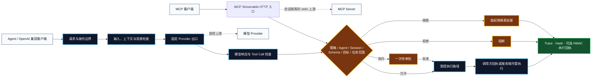
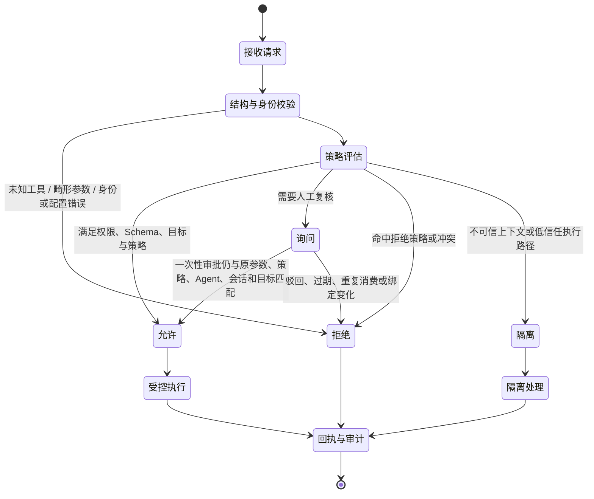
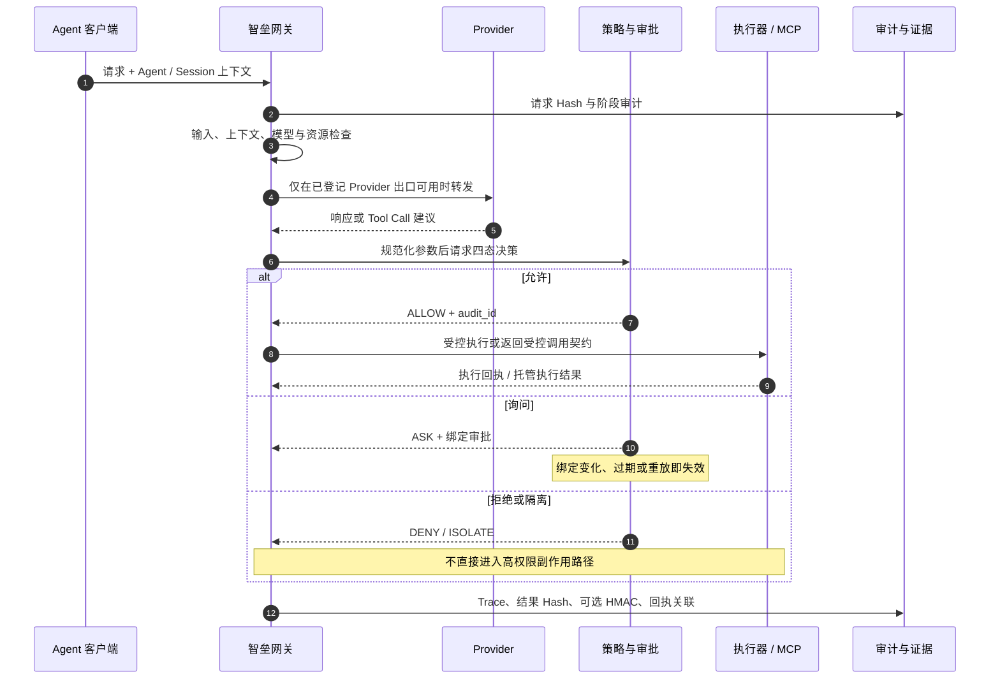
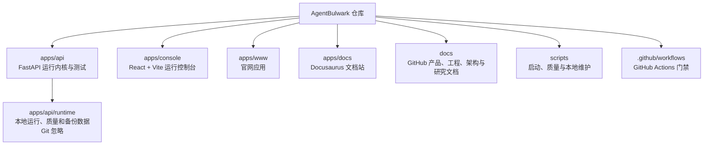

<div align="center">
  
  <h1>AgentBulwark · 智垒</h1>
  <p><strong>面向 OpenAI 兼容 API 与 MCP 的本地优先 AI Agent 运行时防火墙</strong></p>
  <p>把模型请求、工具决策、执行回执和审计证据放进同一条可追踪的运行时链路。</p>
  <p>
    <a href="https://github.com/Chengxiaoyu1119/AgentBulwark/actions/workflows/quality.yml"></a>
    <a href="https://www.python.org/"></a>
    <a href="https://nodejs.org/"></a>
    <a href="https://modelcontextprotocol.io/"></a>
  </p>
  <p>
    <a href="docs/product/产品定位.md">产品定位</a> ·
    <a href="docs/architecture/运行时架构.md">运行时架构</a> ·
    <a href="docs/engineering/安全边界.md">安全边界</a> ·
    <a href="docs/engineering/本地开发.md">本地开发</a> ·
    <a href="docs/README.md">文档中心</a>
  </p>
</div>

> **核心问题**：模型可以提出行动，但不应自行决定副作用。智垒将“谁发起、请求了什么、为何放行、是否执行、执行结果如何”分成可检查、可审计的运行时阶段。

## 从这里开始

| 目标 | 入口 | 你会得到什么 |
| --- | --- | --- |
| 本地启动控制台和 API | [快速开始](#快速开始) | 回环地址上的单机运行环境 |
| 接入 OpenAI 兼容客户端 | [接入面与契约](#接入面与契约) | `/v1` 网关、会话与决策约束 |
| 接入 MCP Server | [运行时架构](docs/architecture/运行时架构.md) | Streamable HTTP 入口和 stdio 上游边界 |
| 评审安全结论 | [安全边界](docs/engineering/安全边界.md) | 明确的信任边界、默认拒绝与证据口径 |
| 了解研究依据 | [研究与产品决策](docs/research/大模型防火墙研究证据与产品决策.md) | 论文事实、工程推论与未证明项 |
| 参与仓库维护 | [协作指南](AGENTS.md) | Issue、PR、验证与提交约定 |

## 运行时全景



图中每个深色节点都是本项目的运行时控制点。Provider 和 MCP Server 位于边界之外；它们的可用性不能替代身份、策略、参数校验或执行回执。

## 决策不是布尔值

策略结果只有四态。它们描述行动在当前上下文中的去向，不把“模型返回了工具建议”误写成“工具已经执行”。



| 决策 | 含义 | 副作用约束 |
| --- | --- | --- |
| `ALLOW` / 允许 | 当前调用满足已登记边界 | 只进入受控执行路径，并保留审计关联 |
| `ASK` / 询问 | 行动需要人工确认 | 审批绑定参数 Hash、策略版本、Agent、会话、目标和有效期；只能消费一次 |
| `DENY` / 拒绝 | 调用违反规则或无法被可靠验证 | 不执行工具 |
| `ISOLATE` / 隔离 | 不可信内容或低信任上下文不能直接进入高权限路径 | 不产生直接的高权限工具副作用 |

## 能力矩阵

| 领域 | 当前实现 | 运行时事实 | 入口或证据 |
| --- | --- | --- | --- |
| OpenAI 网关 | `chat/completions` 流式与非流式 | 请求、输出和 Tool Call 在网关中检查 | `POST /v1/chat/completions` |
| Responses 兼容 | 非流式入口 | 使用同一 OpenAI 网关安全上下文 | `POST /v1/responses` |
| MCP Gateway | Streamable HTTP 对接 stdio 上游 | Agent + Session 维度隔离，工具调用进入策略判断 | `POST /api/mcp` |
| 策略控制 | 工具注册、Schema、目标、权限、任务范围 | 冲突按拒绝优先；未知和畸形输入默认不执行 | [安全边界](docs/engineering/安全边界.md) |
| 人工审批 | 一次性审批与复核接口 | 绑定请求上下文，变化或重放即失效 | `GET /api/approvals` |
| 执行事实 | 调用方回执与服务端托管执行 | 回执与审计记录按 `audit_id` 关联 | `GET /api/runtime/executions` |
| 证据核验 | Hash、可选 HMAC、Trace、回执 | HMAC 未配置时不把 Hash 关联宣传为密码学签名 | `POST /api/evidence/{evidence_id}/verify` |
| 本地控制台 | 防护、事件、设置 | 正式页面读取运行数据，离线或过期状态不伪装为实时数据 | `http://127.0.0.1:8012` |

## 一次请求如何留下证据



`Hash` 用于内容关联与完整性校验；只有配置 `AGENT_SUPERVISOR_AUDIT_HMAC_KEY` 后，审计记录才附带 HMAC 签名。两者的语义不同，项目不把相关性推断标记为密码学证明。

## 适用与边界

| 适用场景 | 智垒提供的控制点 |
| --- | --- |
| Agent 调用内部工具，但团队需要控制权限和副作用 | Agent、Session、工具注册、参数 Schema、任务范围和审批 |
| MCP Server 的工具描述、工具返回或跨会话上下文不稳定 | 工具目录检查、会话隔离、策略与审计链路 |
| OpenAI 兼容客户端需要接入私有或国产 Provider | 后端配置 Provider，固定出口与凭证不进入浏览器 |
| 安全评审需要追溯某一次运行时行动 | Trace、审计 Hash、可选 HMAC、执行回执和验证接口 |

| 当前不承担的职责 | 原因 |
| --- | --- |
| 攻击实验室、任意代码执行器 | 本项目的主链是生产运行时控制，不是攻击载荷执行环境 |
| Docker 沙箱、Kubernetes、多租户 DLP 平台 | 当前仓库未提供这些部署或隔离能力 |
| 对未知攻击的普适检测承诺 | 文本和语义检测是信号层；最终边界仍由确定性授权与执行控制组成 |
| 用内部 fixture 证明真实外部 Provider 安全性 | fixture 闭环只证明当前回归契约，外部烟测需显式配置和运行 |

## 快速开始

**运行基线：Node.js 22+、npm 9.6+、Python 3.11。** 当前一键启动脚本以 PowerShell 为入口，Windows 是首要验证环境；其他系统可使用 API 与各前端子项目的独立命令，但一键脚本不应被当作跨平台承诺。

```powershell
git clone https://github.com/Chengxiaoyu1119/AgentBulwark.git
cd AgentBulwark
npm run install:all
Copy-Item .env.example .env
npm run dev
```

`npm run install:all` 会安装 `apps/console/`、`apps/www/`、`apps/docs/` 的 Node 依赖，以及 `apps/api/` 的 Python 开发依赖；它不需要在仓库根目录安装项目依赖。

启动后打开 [http://127.0.0.1:8012](http://127.0.0.1:8012)，并用下列命令检查服务状态：

```powershell
Invoke-RestMethod http://127.0.0.1:8012/api/public/status
```

默认配置用于本地控制台与开发验证。要把真实模型请求转发给 Provider，需要在 `.env` 中按实际环境配置 Provider，并遵守 [安全边界](docs/engineering/安全边界.md) 中的固定出口和鉴权要求。

## 接入面与契约

| 方法 | 路径 | 用途 | 访问说明 |
| --- | --- | --- | --- |
| `GET` | `/api/public/status` | 启动状态 | 本地启动探针 |
| `POST` | `/v1/chat/completions` | OpenAI Chat Completions 网关 | 支持流式与非流式 |
| `POST` | `/v1/responses` | OpenAI Responses 兼容入口 | 当前为非流式 |
| `POST` | `/api/mcp` | MCP 初始化、发现与工具调用 | 使用 Streamable HTTP 契约 |
| `GET` | `/api/observability/overview` | 控制台运行时总览 | 当前控制台正式数据源 |
| `GET` | `/api/events/stream` | 运行时事件流 | 受鉴权与角色约束 |
| `GET` | `/api/integrations/agents/bundle.md` | 动态生成的接入契约 | 以当前服务配置为准 |
| `POST` | `/api/gateway/tool_calls/{audit_id}/execute` | 服务端托管的已审计调用 | 不接受客户端重传工具参数 |
| `POST` | `/api/evidence/{evidence_id}/verify` | 核验脱敏证据包 | 核验 Hash、签名和回执绑定 |

接入细节、会话 Header、角色模型和透明/托管执行差异见 [运行时架构](docs/architecture/运行时架构.md)。不要把旧的 `/api/overview` 作为新控制台的数据接入面；它保留为兼容接口，不代表当前运行态势。

## 质量门禁

```powershell
# 官网与文档站
npm run www:verify
npm run docs:build

# 控制台、API、类型、覆盖率、浏览器 E2E 与依赖审计
npm run verify

# 仓库内 HTTP Provider + MCP stdio 的确定性闭环
npm run verify:live:fixture
```

`verify:live` 默认记录为未运行。只有显式设置 `AGENT_SUPERVISOR_LIVE_SMOKE=true` 后，它才会访问配置的真实外部 Provider；报告写入被 Git 忽略的 `apps/api/runtime/quality/`。详细参数与失败语义见 [本地开发](docs/engineering/本地开发.md)。

## 仓库地图



| 路径 | 负责内容 | 是否进入 Git |
| --- | --- | --- |
| `apps/api/agent_supervisor/` | FastAPI、网关、MCP、策略、回执和证据实现 | 是 |
| `apps/api/tests/` | 后端回归、协议夹具和确定性闭环素材 | 是 |
| `apps/console/` | 本地运行控制台 | 源码是；依赖与构建产物否 |
| `apps/www/` | 官网应用 | 源码是；依赖与构建产物否 |
| `apps/docs/` | Docusaurus 文档站 | 源码是；构建产物否 |
| `docs/` | GitHub 可读的产品、工程、架构和研究文档 | 是 |
| `scripts/` | 启动、检查、清理和闭环验证脚本 | 是 |
| `apps/api/runtime/` | operational、quality、backups 等本地数据 | 否 |

## 文档地图

| 文档 | 适合谁读 | 内容 |
| --- | --- | --- |
| [产品定位](docs/product/产品定位.md) | 产品、架构与安全负责人 | 用户、问题定义、能力和非目标 |
| [运行时架构](docs/architecture/运行时架构.md) | 接入与后端工程师 | 请求链路、执行模式、数据边界和接口地图 |
| [安全边界](docs/engineering/安全边界.md) | 安全评审与运维 | 信任边界、角色、拒绝默认值和证据语义 |
| [本地开发](docs/engineering/本地开发.md) | 开发者 | 安装、启动、验证、数据目录与清理方式 |
| [研究与产品决策](docs/research/大模型防火墙研究证据与产品决策.md) | 研究与产品决策者 | 外部证据、工程映射、验证缺口 |
| [文档中心](docs/README.md) | 所有人 | 阅读路径和文档治理规则 |

## 安全报告与贡献

安全问题请使用 [GitHub Security Advisory 私密报告](https://github.com/Chengxiaoyu1119/AgentBulwark/security/advisories/new)，并提供最小复现、影响范围和已观察到的行为。普通工程改动遵循 [AGENTS.md](AGENTS.md)：先读相关代码和测试，保持改动局部，并用对应质量门禁验证。
