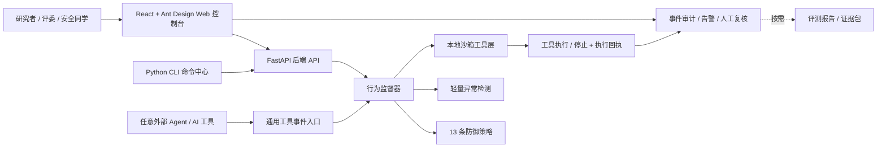
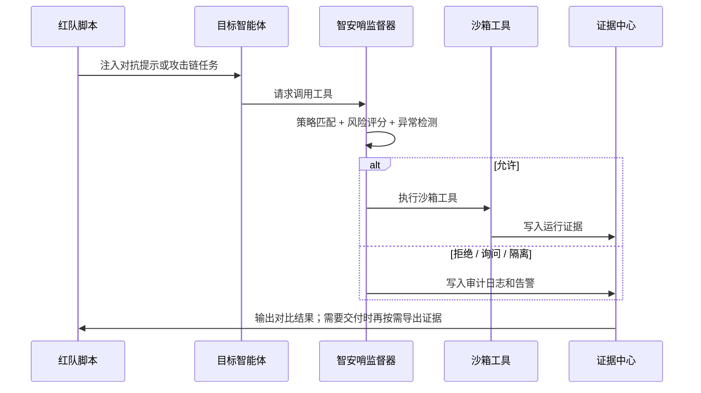
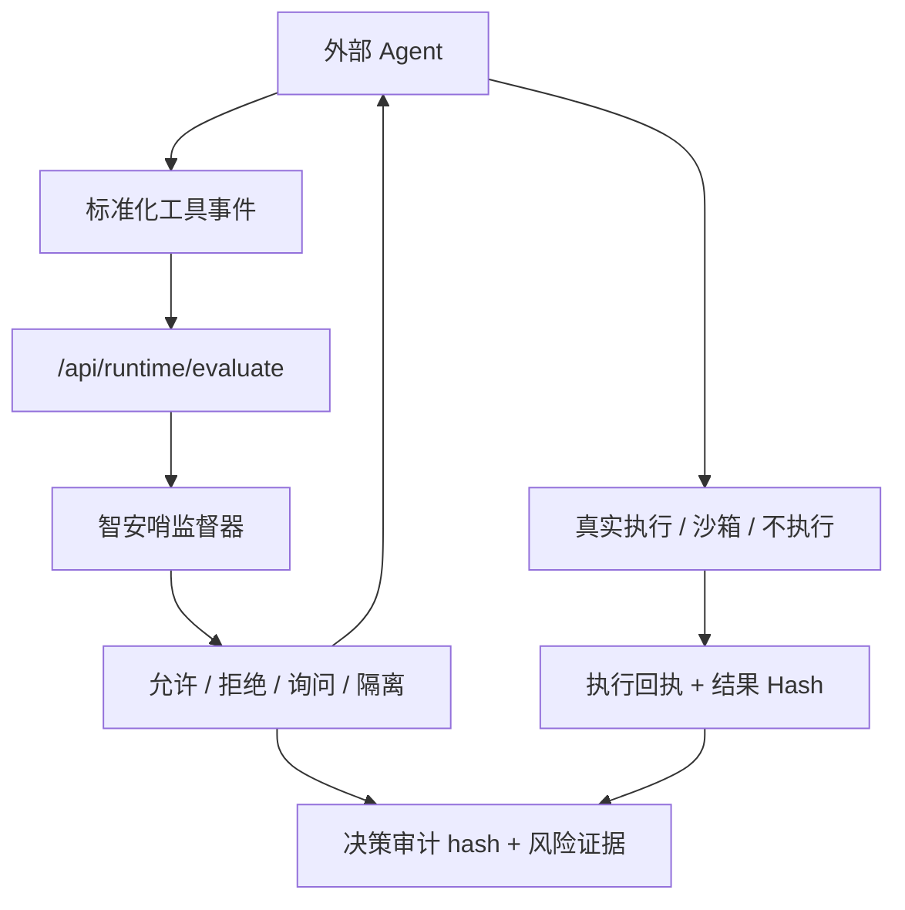

<p align="center">
  
</p>

<p align="center">
  
</p>

<h1 align="center">智安哨：面向大模型智能体工具调用链的运行时行为防火墙与评测系统</h1>

<p align="center">
  <strong>面向 LLM Agent 的攻击复现、工具调用监督、证据留痕、策略评测与通用框架接入。</strong>
</p>

<p align="center">
  
</p>

<p align="center">
  <a href="#快速启动"></a>
  <a href="#系统架构"></a>
  <a href="#安全边界"></a>
  <a href="#命令中心"></a>
</p>

<p align="center">
  
  
  
  
  
  
</p>

---

## 项目概览

智安哨把安全检查点从模型对话层前移到工具执行层，在文件、邮件、API、代码和记忆工具产生副作用前完成规范化、判定、阻断、复核与留痕。

它面向大模型及智能体应用安全研究，重点验证提示注入、模型越狱、数据泄露、工具调用劫持、记忆中毒、环境感知污染和滥用风险。

> [!IMPORTANT]
> 本项目通过受控实验环境和模拟业务数据复现风险。它的目标是研究和验证智能体安全防护，不会攻击真实外部系统。

```text
Agent 工具调用 -> 执行前监督 -> 允许 / 拒绝 / 询问 / 隔离
        -> 工具执行或停止 -> 执行回执 -> 事件审计与人工复核
```

<table>
  <tr>
    <td align="center"><strong>7</strong><br />攻击面</td>
    <td align="center"><strong>22</strong><br />攻击脚本</td>
    <td align="center"><strong>13</strong><br />防御策略</td>
    <td align="center"><strong>5</strong><br />主导航入口</td>
    <td align="center"><strong>Agent</strong><br />通用接入</td>
    <td align="center"><strong>Hash</strong><br />审计链</td>
  </tr>
</table>

## 导航

- [项目概览](#项目概览)
- [核心能力](#核心能力)
- [系统架构](#系统架构)
- [攻击面矩阵](#攻击面矩阵)
- [快速启动](#快速启动)
- [模型配置](#模型配置)
- [命令中心](#命令中心)
- [接口地图](#接口地图)
- [安全边界](#安全边界)
- [项目结构](#项目结构)
- [质量检查](#质量检查)
- [常见问题](#常见问题)

## 核心能力

| 模块 | 能力 | 代码入口 |
|---|---|---|
| 运行总览 | 展示服务、模型、风险事件、待确认回执和真实调用链状态 | `apps/console/src/pages/Dashboard.tsx` |
| 事件与复核 | 合并审计、告警、审批队列和执行回执，形成处置闭环 | `apps/console/src/pages/AuditLogPanel.tsx` |
| 攻防验证 | 支持单次攻防对照、真实 Agent 验证、批量回归和高级攻击研究 | `apps/console/src/components/lab/ExperimentLab.tsx` |
| 防护策略 | 管理工具调用策略、风险阈值和处置规则 | `apps/console/src/components/policy/PolicyCenter.tsx` |
| 行为监督器 | 对工具调用输出允许、拒绝、询问、隔离四类决策 | `apps/api/agent_supervisor/supervisor.py` |
| 审计与告警 | 记录工具参数、策略命中、风险分、异常分、审计 hash | `apps/api/agent_supervisor/integrity.py` |
| 按需证据导出 | 为比赛复核、工程复盘和材料提交导出指标，不参与运行时判定 | `apps/api/agent_supervisor/evidence.py` |
| 通用 Agent 接入 | 提供 HTTP 事件契约、AgentToolGuard、OpenAI Agents/LangChain/LangGraph 示例；OpenClaw 作为可选插件 | `apps/api/agent_supervisor/adapters/integrations/agent_integrations.py` |

> [!NOTE]
> “监督器”可以理解为智能体的安全检查员。每次智能体想调用文件、邮件、API、代码执行、记忆或环境变量工具时，它先判断这次调用能不能放行。

### Web 控制台

| 页面 | 用途 |
|---|---|
| 运行总览 | 查看服务、模型、风险事件、待确认回执和最近工具调用链 |
| 事件与复核 | 集中处理审计、告警、审批和执行回执 |
| 攻防验证 | 用户直接提交 Payload、工具名、JSON 参数或命令，对同一调用运行无防护与有防护路径并展示实际副作用；预置案例仅用于回归 |
| 防护策略 | 配置工具调用边界、风险判定和四类处置规则 |
| Agent 接入 | 接入通用 Agent 事件契约和模型连接；OpenClaw 位于可选适配器中 |

攻击场景库、多 Agent 攻击链、安全事件和按需证据导出仍保留为深链接或高级能力，不占用 5 个主导航入口。评测报告只服务复核和材料导出，不属于运行时监督主流程。

## 系统架构





## 攻击面矩阵

| 攻击面 | 风险 | 状态 | 样本 | 脚本 | 典型风险 |
|---|---|---|---:|---:|---|
| 提示注入 | high | 可演示 | 18 | 6 | 让外部内容覆盖系统规则 |
| 模型越狱 | high | 可演示 | 9 | 3 | 诱导模型绕过安全约束 |
| 数据泄露 | critical | 可演示 | 18 | 6 | 读取队伍、赛题、提交物、密钥等敏感数据 |
| 滥用风险 | medium | 可演示 | 13 | 5 | 批量外发、垃圾邮件、未授权导出 |
| 工具调用劫持 | critical | 可演示 | 17 | 6 | 通过工具返回或参数污染劫持执行链 |
| 记忆中毒 | high | 可演示 | 9 | 3 | 写入恶意长期记忆，影响未来决策 |
| 环境感知污染 | medium | 可演示 | 12 | 4 | 伪造环境变量或运行上下文 |

<details>
<summary><strong>内置脚本分布</strong></summary>

| 攻击面编号 | 脚本数 |
|---|---:|
| `tool-hijack` | 4 |
| `prompt-injection` | 3 |
| `data-leakage` | 4 |
| `memory-poison` | 2 |
| `jailbreak` | 3 |
| `abuse-risk` | 3 |
| `environment-pollution` | 3 |

</details>

## 防御策略矩阵

| 策略 ID | 策略名称 | 默认 | 主要动作 |
|---|---|---|---|
| `path-boundary` | 文件沙箱边界 | 开启 | 拒绝越界读写 |
| `dangerous-command` | 危险命令拦截 | 开启 | 拒绝高危命令 |
| `code-sandbox` | 代码执行沙箱 | 开启 | 隔离代码运行 |
| `external-mail` | 邮件外发询问 | 开启 | 人工确认外部邮件 |
| `sensitive-api` | 高敏 API 审计 | 开启 | 拒绝未授权高敏接口 |
| `memory-write` | 记忆写入隔离 | 开启 | 隔离污染型记忆 |
| `memory-read-sensitive` | 敏感记忆读取拦截 | 开启 | 拒绝敏感检索 |
| `jailbreak-filter` | 越狱提示过滤 | 开启 | 拒绝越狱提示 |
| `model-output-filter` | 模型输出过滤 | 开启 | 拒绝高风险输出 |
| `bulk-action-review` | 批量动作复核 | 开启 | 询问批量导出或批量外发 |
| `tool-return-trust` | 工具返回低信任隔离 | 开启 | 隔离不可信工具返回 |
| `environment-trust` | 环境信息低信任隔离 | 开启 | 隔离被污染环境信号 |
| `anomaly-detection` | 轻量异常检测 | 开启 | 按异常分询问或拒绝 |

## 快速启动

依赖可以理解为项目运行需要的“工具包”。第一次运行先安装依赖，之后通常不用重复安装。

### 0. 前置环境

- Node.js 22.0 或更高版本。官网和控制台都使用 Vite + React，Node 22.11.0 可以直接运行。
- Python 3.10 或更高版本。后端 API 和命令行工具依赖 Python。

### 1. 安装依赖

```bash
npm --prefix apps/console install
npm --prefix apps/www install
npm --prefix apps/docs install
python -m pip install -r apps/api/requirements.txt
```

### 2. 启动后端 API

```bash
npm run api
```

后端默认地址：

```text
http://127.0.0.1:8012
```

健康检查：

```text
http://127.0.0.1:8012/api/health
```

### 3. 启动前端页面

```bash
npm run console:dev
```

打开：

```text
http://127.0.0.1:5178
```

> [!TIP]
> 如果后端没启动，前端会使用内置样本兜底展示。要记录真实实验日志，需要同时启动后端。

### 4. 生成服务器精简源码包

服务器源码包只包含 Git 已提交的项目文件，会排除 `.env`、`node_modules`、构建产物、缓存、日志、本地数据库和测试文件。它适合上传到宝塔后在服务器上安装依赖、构建前端并启动后端。

```bash
npm run package:server
```

生成位置：

```text
部署包/
```

## 模型配置

项目不强制要求真实模型密钥。不填密钥时，系统会使用本地目标夹具和沙箱副作用断言演示攻防对照、行为监督、告警和报告；未产生可观察副作用的脚本会如实标记为未复现。

如果要接入真实 DeepSeek 或智谱模型，把 `.env.example` 复制为 `.env`，然后填入对应密钥：

```bash
MODEL_REAL_API_ENABLED=true
MODEL_PROVIDER_PRIORITY=deepseek,zhipu
MODEL_TIMEOUT_SECONDS=12

AGENT_SUPERVISOR_AUTH_DISABLED=true
AGENT_SUPERVISOR_API_TOKEN=
AGENT_SUPERVISOR_AUDIT_HMAC_KEY=

DEEPSEEK_API_KEY=你的 DeepSeek Key
DEEPSEEK_BASE_URL=https://api.deepseek.com
DEEPSEEK_MODEL=deepseek-v4-pro

ZHIPU_API_KEY=你的智谱 Key
ZHIPU_API_URL=https://open.bigmodel.cn/api/paas/v4/chat/completions
ZHIPU_MODEL=glm-4.6v-flashx
```

| 配置项 | 含义 | 不配置时 |
|---|---|---|
| `MODEL_REAL_API_ENABLED` | 是否允许调用真实模型 | 使用默认值 `false`，默认走本地模拟 |
| `MODEL_PROVIDER_PRIORITY` | 真实模型优先级 | `deepseek,zhipu` |
| `MODEL_TIMEOUT_SECONDS` | 请求超时时间 | 12 秒 |
| `AGENT_SUPERVISOR_AUTH_DISABLED` | 是否关闭 API 鉴权 | 公网演示可设为 `true`；这只影响后端接口访问校验，不影响大模型调用 |
| `AGENT_SUPERVISOR_API_TOKEN` | API 访问令牌 | 关闭鉴权时可留空；开启鉴权时必须配置 |
| `AGENT_SUPERVISOR_API_TOKEN_ADMIN` | 管理员专用令牌 | 可选；角色由服务端令牌映射，不接受客户端自报管理员 |
| `AGENT_SUPERVISOR_AGENT_TOKENS_JSON` | 每个 Agent 独立令牌映射 | 生产推荐；例如 `{"agent-1":"长随机Token"}`，服务端据此校验 `agent_id` |
| `AGENT_SUPERVISOR_API_TOKEN_EXECUTOR` | 共享执行器令牌 | 仅兼容旧接入；默认不允许代表具体 Agent 执行生产操作 |
| `AGENT_SUPERVISOR_ALLOW_SHARED_EXECUTOR_TOKEN` | 共享执行器兼容开关 | 默认 `false`；开启后降低 Agent 身份隔离强度 |
| `AGENT_SUPERVISOR_API_TOKEN_ANALYST` | 分析员专用令牌 | 可选；用于人工复核和记忆治理 |
| `AGENT_SUPERVISOR_API_TOKEN_OBSERVER` | 只读观察员令牌 | 可选；用于查看日志和报告 |
| `AGENT_SUPERVISOR_AUDIT_HMAC_KEY` | 审计记录签名密钥 | 留空时只有 SHA-256 完整性校验；配置后增加 HMAC 签名 |
| `DEEPSEEK_API_KEY` | DeepSeek 密钥 | 不调用 DeepSeek |
| `ZHIPU_API_KEY` | 智谱密钥 | 不调用智谱 |

## 命令中心

CLI 是命令行工具。它用于批量回归、材料复核和按需导出，不参与 Agent 每次工具调用的运行时判定。不会影响前端页面，只是在本地运行项目提供的 Python 模块。

| 目标 | 命令 |
|---|---|
| 运行单个攻击脚本 | `node scripts/agent-supervisor-cli.mjs run TOOL-HIJACK-001 on` |
| 批量运行全部脚本对比 | `node scripts/agent-supervisor-cli.mjs batch --guard compare` |
| 导出攻防有效性评测 | `node scripts/agent-supervisor-cli.mjs assess --run-compare` |
| 评估外部智能体事件日志 | `node scripts/agent-supervisor-cli.mjs evaluate --input apps/api/sandbox/examples/agent-events-batch.json` |
| 运行通用外部 Agent 批量接入演示 | `node scripts/agent-supervisor-cli.mjs demo-external` |
| 运行带 Token/HMAC 的通用 Agent 端到端演示 | `node scripts/agent-supervisor-cli.mjs external-agent-demo --managed-server` |
| 运行策略消融实验 | `node scripts/agent-supervisor-cli.mjs policy-ablation` |
| 运行200条冻结集、四组基线与性能评测 | `node scripts/agent-supervisor-cli.mjs competition-benchmark` |
| 运行3轮独立复现一致性验收 | `node scripts/agent-supervisor-cli.mjs repro-check --trials 3 --operator OPERATOR --operator-role ROLE` |
| 生成上海作品赛材料草稿 | `python -X utf8 scripts/build_shanghai_competition_materials.py --profile docs/上海信息安全/参赛材料草稿/参赛信息填写模板.json` |
| 审查历史参赛/获奖资格 | `python -X utf8 scripts/audit_shanghai_eligibility.py` |
| 运行HTTP、SQLite与审计完整链路性能评测 | `node scripts/agent-supervisor-cli.mjs http-e2e-benchmark` |
| 导出单个攻击面证据包 | `node scripts/agent-supervisor-cli.mjs surface-pack --surface prompt-injection --output apps/api/sandbox/reports` |
| 一键导出全部攻击面证据包 | `node scripts/agent-supervisor-cli.mjs surface-packs --output apps/api/sandbox/reports` |
| 赛前一键体检 | `node scripts/agent-supervisor-cli.mjs readiness --write` |
| OpenClaw 插件包生成 | `node scripts/agent-supervisor-cli.mjs openclaw-plugin` |
| OpenClaw 插件包验证 | `node scripts/agent-supervisor-cli.mjs openclaw-plugin-validate` |

<details>
<summary><strong>评委演示建议流程</strong></summary>

1. 打开 Web 控制台：`http://127.0.0.1:5178`，在“运行总览”确认服务和模型状态
2. 进入“攻防验证”，选择 `TOOL-HIJACK-001`
3. 点击对比运行，展示无防护和有防护结果差异
4. 进入“事件与复核”，展示策略命中、监督决策、执行回执和审计 hash
5. 需要交付材料时再进入“证据导出（按需）”，生成攻击面覆盖、误报率、策略消融和路线图证据
6. 进入“Agent 接入”，查看通用 Agent 接入包、模型连接和折叠在高级区域的 OpenClaw 可选适配器

</details>

## 接口地图

| 分组 | 接口 | 用途 |
|---|---|---|
| 健康检查 | `GET /api/health` | 确认后端是否运行 |
| 总览 | `GET /api/overview` | 首页统计、模型状态、近期日志 |
| 脚本 | `GET /api/scenarios` | 获取攻击脚本列表 |
| 运行 | `POST /api/run` | 运行单个脚本 |
| 对比 | `POST /api/compare` | 对比无防护和有防护结果 |
| 批量 | `POST /api/batch_compare` | 批量对比多个脚本 |
| 攻击链 | `GET /api/attack_chains` | 获取组合攻击链 |
| 攻击链运行 | `POST /api/attack_chains/{chain_id}/run` | 运行指定组合链 |
| 审计 | `GET /api/audit_logs` | 获取工具调用审计记录 |
| 告警 | `GET /api/alerts` | 获取阻断、询问、隔离告警 |
| 策略 | `GET /api/policies` | 获取防御策略 |
| 策略更新 | `PATCH /api/policies/{policy_id}` | 开关某条策略 |
| 工具注册表 | `GET /api/tool_registry` | 查询自定义工具到标准安全能力的映射和 Agent 白名单 |
| 按需证据 | `GET /api/report` | 复核、答辩或提交时生成综合证据（运行时防护不依赖） |
| 对抗留出集 | `GET /api/evaluations/adversarial_holdout` | 运行人工固定标签的攻击/正常样本独立评测 |
| 最近一次真实模型盲测 | `GET /api/evaluations/real_model/latest` | 读取已落盘的同一工具调用双分支因果对照、模型来源、副作用、监督决策与执行回执，不重新调用模型 |
| 证据包 | `GET /api/attack_surfaces/evidence_packs` | 获取攻击面证据包索引 |
| 生产外部事件 | `POST /api/runtime/evaluate` | 评估单个外部 Agent 工具事件，服务端强制开启防护（**建议式 API**，需接入方自行遵守决策） |
| 生产批量事件 | `POST /api/runtime/batch_evaluate` | 批量评估外部 Agent 事件，服务端强制开启防护（**建议式 API**，需接入方自行遵守决策） |
| 外部执行回执 | `POST /api/runtime/executions/{audit_id}/complete` | 回传真实执行、沙箱执行、失败或未执行结果，并绑定原工具调用 Hash |
| 回执查询 | `GET /api/runtime/executions` | 查询回执状态、结果 Hash、回执 Hash 和签名 |
| 实验对照事件 | `POST /api/lab/evaluate` | 仅供分析员运行有/无防护对照 |
| 旧版兼容入口 | `POST /api/supervisor/evaluate` | 保留旧接入，但行为等同生产接口 |

生产 Agent Token 与 `agent_id` 由服务端绑定；外部目标测试固定经过公网校验的 DNS 解析 IP，并保留原域名完成 HTTPS SNI 与证书校验，3xx 响应不会被自动跟随。
| 通用 Agent 接入包 | `GET /api/integrations/agents/bundle` | 获取通用 HTTP、OpenAI Agents、LangChain、LangGraph 接入示例 |
| 通用 Agent 演示 | `POST /api/integrations/agents/minimal_demo` | 运行工具执行前监督演示并生成审计证据 |
| 模型驱动 Agent | `POST /api/integrations/agents/model_driven_demo` | 由模型生成工具调用，完成监督、沙箱处置、执行回执与工具结果回灌；区分协议闭环和严格真实模型证据 |
| OpenClaw | `GET /api/integrations/openclaw/bundle` | 获取 OpenClaw 接入包 |
| OpenClaw 事件 | `POST /api/integrations/openclaw/events` | OpenClaw 风格工具调用监督入口 |

## 通用外部 Agent 与可选 OpenClaw

智安哨可以作为外部 Agent 的工具调用防火墙。外部系统把即将执行的工具调用发给智安哨，智安哨返回是否允许、拒绝、询问或隔离。

> [!IMPORTANT]
> **强制式 vs 建议式接入说明（需求 F3）**
>
> | 接入方式 | 强制力 | 说明 |
> |---|---|---|
> | OpenClaw 插件 | **强制式** | 插件在 `before_tool_call` 钩子中返回 `block:true`，工具调用 100% 不执行，人工无法放行 |
> | MCP Gateway（开源版本） | **强制式** | Agent 连接 Gateway，Gateway 代理真实 MCP Server，工具调用必须经过 supervisor 拦截 |
> | 通用 HTTP 接入 | **建议式** | 智安哨返回决策和审计编号，但是否遵守由接入方控制。接入方忽略决策继续执行时，智安哨无法在运行时强制阻断 |
>
> 通用 HTTP 接入（`POST /api/runtime/evaluate`）属于**建议式 API**：智安哨不替代接入方执行工具，也不强制阻断。需要强制阻断时，请使用 OpenClaw 插件或 MCP Gateway。



最小事件示意：

```json
{
  "conversation_id": "demo-conv",
  "agent_id": "external-agent-1",
  "agent_role": "assistant",
  "tool_call": {
    "tool": "file.read",
    "arguments": {
      "path": "confidential/competition-teams.csv"
    }
  },
  "guard_enabled": true,
  "execute_in_sandbox": false
}
```

## 证据与报告

项目会把运行结果沉淀成可复查材料，方便比赛答辩、论文式分析或工程复盘。报告按需读取现有审计和实验数据，不是运行时防护的前置条件，也不占用主导航入口。

| 产物 | 内容 |
|---|---|
| 攻击面证据包 | 每类攻击面的样本、脚本、策略命中、工具覆盖、缺口提示 |
| 攻防有效性评测 | 无防护是否复现攻击，有防护是否有效控制 |
| 正常任务误报评测 | 正常业务任务是否被错误拦截 |
| 连续流程误报评测 | 多步骤正常任务流程是否能顺利完成 |
| 异常检测阈值校准 | 推荐异常分阈值、攻击召回率、正常误报率 |
| 200条冻结集与基线性能评测 | 无 risk_hint 的100条攻击、100条正常样本，四组基线和P50/P95/P99性能；明确标记为内部回归集 |
| 独立复现一致性验收 | 固定源码与策略哈希重复运行3次，核对冻结集、四组基线、通用Agent、Token、审计Hash与HMAC结果是否漂移；保留非作者签署入口 |
| HTTP、SQLite与审计完整链路性能评测 | 覆盖Token鉴权、HTTP、监督决策、SQLite写入、审计Hash与HMAC签名 |
| 策略消融实验 | 关闭某条策略后风险是否暴露，兜底策略是否生效 |
| 赛前一键体检 | 攻击面、误报、通用Agent端到端、完整链路性能、部署安全和正式提交材料就绪情况 |
| 干净提交包 | 不混用历史调试记录的交付目录和压缩包 |

## 安全边界

> [!CAUTION]
> 仓库里包含攻击样本、越狱样例和工具滥用场景，但它们只用于受控实验环境研究。不要把这些样例用于真实系统攻击。

| 工具类型 | 边界 |
|---|---|
| 邮件工具 | 只写入假 outbox，不发送真实邮件 |
| 文件工具 | 只访问沙箱目录，不读取用户真实文件 |
| API 工具 | 只访问本地模拟参赛队伍、提交物、复盘记录、成绩榜数据 |
| 代码执行工具 | 登记探针以参数数组运行；其他用户命令优先进入无网络、只读根文件系统、资源受限的一次性 Docker 容器，Windows 下 Docker 离线时使用 WSL2 mount/PID/network namespace，并返回退出码与输出 |
| 记忆工具 | 只使用演示数据，支持隔离和重置 |
| 环境工具 | 环境信息只作为低信任上下文，不覆盖安全策略 |
| 审计数据 | Token、密码、API Key、邮箱等直接标识在落库前脱敏；可选HMAC签名增强篡改检测 |

## 项目结构

```text
agent-security-supervisor/
├─ apps/
│  ├─ api/                           # FastAPI、监督器、评测、报告、CLI
│  │  ├─ agent_supervisor/           # 后端 Python 包
│  │  ├─ sandbox/                    # 受控实验数据、示例事件、报告输出
│  │  └─ tests/                      # 后端单元测试
│  ├─ console/                       # React + Vite 控制台
│  │  └─ src/                        # 页面、组件、类型、样式和请求封装
│  ├─ www/                           # Vite + React 官网介绍页
│  └─ docs/                          # Docusaurus 正式文档站
├─ docs/                             # 历史开发记录、方案和过程材料
├─ scripts/                          # 前端治理检查、自审脚本
├─ package.json                      # 根目录统一命令入口
└─ apps/api/requirements.txt         # Python 后端依赖
```

## 质量检查

| 检查 | 命令 | 说明 |
|---|---|---|
| 控制台构建 | `npm run console:build` | TypeScript 类型检查 + Vite 构建 |
| 前端治理检查 | `npm run ui:audit` | 检查前端结构和治理规则 |
| 项目自审 | `npm run self:review` | 输出项目自审报告到沙箱报告目录 |
| 后端健康 | `GET /api/health` | 确认 FastAPI 服务正常 |
| 攻防评测 | `node scripts/agent-supervisor-cli.mjs assess --run-compare` | 对全部脚本跑攻防对比 |

## 常见问题

<details>
<summary><strong>没有模型 key 能不能演示？</strong></summary>

可以。项目会使用本地目标夹具和模拟模型演示攻防对照、监督决策、告警、审计和报告，并明确展示已复现风险与证据缺口。

</details>

<details>
<summary><strong>前端打开后没有真实运行数据？</strong></summary>

先确认后端是否启动：`npm run api`。后端启动后，运行脚本才会写入真实实验日志。

</details>

<details>
<summary><strong>端口被占用怎么办？</strong></summary>

后端默认 `8012`，前端默认 `5178`。如果端口被占用，可以在 `package.json` 里调整脚本端口，或者先关闭占用端口的旧服务。

</details>

<details>
<summary><strong>为什么 README 里有远程动效图片？</strong></summary>

这是 GitHub README 的展示组件，用于增强项目首页观感。它不会参与项目运行，也不会影响本地代码。

</details>

## 路线图

- 扩展更多真实 Agent 框架适配器。
- 增加更细粒度的数据脱敏和字段级访问控制。
- 增强异常检测阈值的自动校准和可解释性。
- 增加更多正常业务流程样本，继续降低误报。
- 增加端到端截图和答辩演示自动化。

## 许可证

当前仓库未包含 `LICENSE` 文件。公开发布或对外复用前，建议补充开源许可证、比赛提交声明或内部使用说明。

<p align="center">
  
</p>
