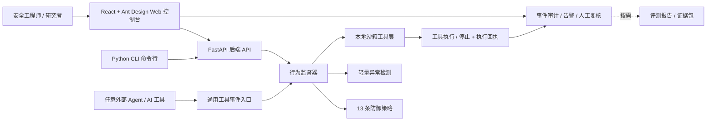
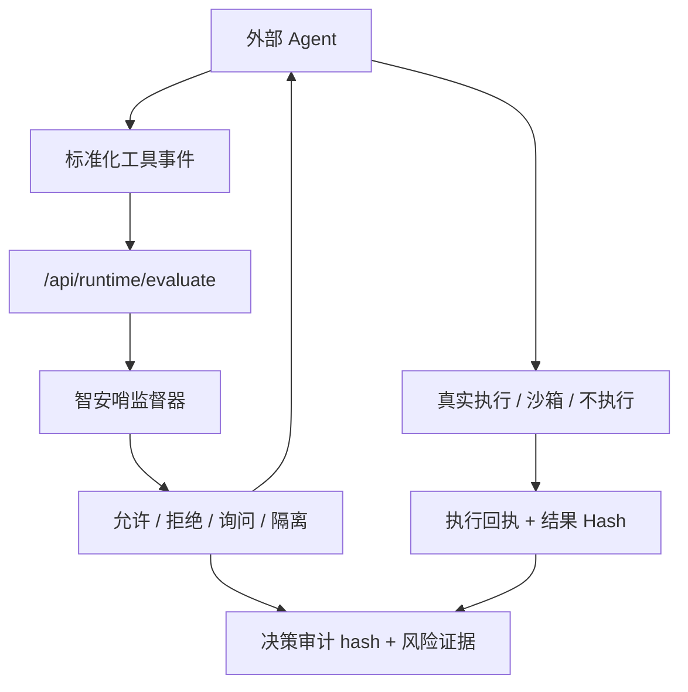

<p align="center">
  
</p>

<h1 align="center">智安哨 ZhiAn Sentinel</h1>

<p align="center">
  <strong>面向大模型智能体工具调用链的运行时行为防火墙与评测系统</strong>
</p>

<p align="center">
  <strong>Runtime behavioral firewall and evaluation system for LLM agent tool-call chains.</strong>
</p>

<p align="center">
  
  
  
  
  
</p>

<p align="center">
  <a href="#快速启动">快速启动</a> ·
  <a href="#接入方式">接入方式</a> ·
  <a href="./CONTRIBUTING.md">参与贡献</a> ·
  <a href="./README_EN.md">English</a>
</p>

---

## 项目概览

智安哨把安全检查点从模型对话层前移到工具执行层，在文件、邮件、API、代码和记忆工具产生副作用前完成规范化、判定、阻断、复核与留痕。

它面向大模型及智能体应用安全研究与防护，重点覆盖提示注入、模型越狱、数据泄露、工具调用劫持、记忆中毒、环境感知污染和滥用风险，并与 OWASP Agentic Security 风险清单对齐。

> [!IMPORTANT]
> 本项目通过受控实验环境和模拟业务数据复现风险。它的目标是研究和验证智能体安全防护，不会攻击真实外部系统。

```text
Agent 工具调用 -> 执行前监督 -> 允许 / 拒绝 / 询问 / 隔离
        -> 工具执行或停止 -> 执行回执 -> 事件审计与人工复核
```

<table>
  <tr>
    <td align="center"><strong>7</strong><br />攻击面</td>
    <td align="center"><strong>22</strong><br />攻击样本集</td>
    <td align="center"><strong>13</strong><br />防御策略</td>
    <td align="center"><strong>4</strong><br />处置决策</td>
    <td align="center"><strong>Agent</strong><br />通用接入</td>
    <td align="center"><strong>Hash+HMAC</strong><br />审计链</td>
  </tr>
</table>

## 核心能力

| 模块 | 能力 | 代码入口 |
|---|---|---|
| 运行总览 | 展示服务、模型、风险事件、待确认回执和真实调用链状态 | `apps/console/src/pages/Dashboard.tsx` |
| 事件与复核 | 合并审计、告警、审批队列和执行回执，形成处置闭环 | `apps/console/src/pages/AuditLogPanel.tsx` |
| 攻防验证 | 支持单次攻防对照、真实 Agent 验证、批量回归和高级攻击研究 | `apps/console/src/components/lab/ExperimentLab.tsx` |
| 防护策略 | 管理工具调用策略、风险阈值和处置规则 | `apps/console/src/components/policy/PolicyCenter.tsx` |
| 行为监督器 | 对工具调用输出允许、拒绝、询问、隔离四类决策 | `apps/api/agent_supervisor/domains/governance/supervisor.py` |
| 审计与告警 | 记录工具参数、策略命中、风险分、异常分、审计 hash | `apps/api/agent_supervisor/domains/governance/integrity.py` |
| 评测与证据 | 攻防有效性、误报、消融、基准与证据包导出 | `apps/api/agent_supervisor/domains/evaluations/` |
| 通用 Agent 接入 | HTTP 事件契约、AgentToolGuard、OpenAI Agents/LangChain/LangGraph 示例 | `apps/api/agent_supervisor/adapters/integrations/agent_integrations.py` |

## 系统架构



## 接入方式

智安哨可以作为外部 Agent 的工具调用防火墙。外部系统把即将执行的工具调用发给智安哨，智安哨返回是否允许、拒绝、询问或隔离。

| 接入方式 | 强制力 | 说明 |
|---|---|---|
| OpenClaw 插件 | **强制式** | 插件在 `before_tool_call` 钩子中返回 `block:true`，工具调用 100% 不执行 |
| MCP Gateway | **强制式** | Agent 连接 Gateway（`POST /api/mcp`），Gateway 代理真实 MCP Server（stdio），所有 `tools/call` 必须经过监督器，拒绝/隔离/询问时不转发上游 |
| 通用 HTTP 接入 | **建议式** | 智安哨返回决策和审计编号，但是否遵守由接入方控制 |

> [!IMPORTANT]
> 通用 HTTP 接入（`POST /api/runtime/evaluate`）属于**建议式 API**：智安哨不替代接入方执行工具，也不强制阻断。需要强制阻断时，请使用 OpenClaw 插件或 MCP Gateway。
>
> MCP Gateway 通过环境变量启用：`MCP_GATEWAY_UPSTREAM_COMMAND` 指向上游 MCP Server 启动命令（如 `npx -y @modelcontextprotocol/server-filesystem /sandbox`）。自定义 MCP 工具名需在策略设置的 `agent_tool_mappings` 中映射到标准能力，否则会被 tool-contract 策略拒绝。



最小事件示意：

```json
{
  "conversation_id": "demo-conv",
  "agent_id": "external-agent-1",
  "agent_role": "assistant",
  "tool_call": {
    "tool": "file.read",
    "arguments": { "path": "confidential/competition-teams.csv" }
  },
  "guard_enabled": true,
  "execute_in_sandbox": false
}
```

## 攻击面矩阵

| 攻击面 | 风险 | 样本 | 典型风险 |
|---|---|---:|---|
| 提示注入 | high | 18 | 让外部内容覆盖系统规则 |
| 模型越狱 | high | 9 | 诱导模型绕过安全约束 |
| 数据泄露 | critical | 18 | 读取敏感数据并外发 |
| 滥用风险 | medium | 13 | 批量外发、垃圾邮件、未授权导出 |
| 工具调用劫持 | critical | 17 | 通过工具返回或参数污染劫持执行链 |
| 记忆中毒 | high | 9 | 写入恶意长期记忆，影响未来决策 |
| 环境感知污染 | medium | 12 | 伪造环境变量或运行上下文 |

## 防御策略矩阵

| 策略 ID | 策略名称 | 默认 | 主要动作 |
|---|---|---|---|
| `path-boundary` | 文件沙箱边界 | 开启 | 拒绝越界读写 |
| `dangerous-command` | 危险命令拦截 | 开启 | 拒绝高危命令 |
| `code-sandbox` | 代码执行沙箱 | 开启 | 隔离代码运行 |
| `external-mail` | 邮件外发询问 | 开启 | 人工确认外部邮件 |
| `sensitive-api` | 高敏 API 审计 | 开启 | 拒绝未授权高敏接口 |
| `memory-write` | 记忆写入隔离 | 开启 | 隔离污染型记忆 |
| `memory-read-sensitive` | 敏感记忆读取拦截 | 开启 | 拒绝敏感检索 |
| `jailbreak-filter` | 越狱提示过滤 | 开启 | 拒绝越狱提示 |
| `model-output-filter` | 模型输出过滤 | 开启 | 拒绝高风险输出 |
| `bulk-action-review` | 批量动作复核 | 开启 | 询问批量导出或批量外发 |
| `tool-return-trust` | 工具返回低信任隔离 | 开启 | 隔离不可信工具返回 |
| `environment-trust` | 环境信息低信任隔离 | 开启 | 隔离被污染环境信号 |
| `anomaly-detection` | 轻量异常检测 | 开启 | 按异常分询问或拒绝 |

## 快速启动

### 前置环境

- Node.js 22.0 或更高版本
- Python 3.10 或更高版本

### 1. 安装依赖

```bash
npm --prefix apps/console install
python -m pip install -r apps/api/requirements.txt
```

开发环境（含测试与类型检查工具）：

```bash
python -m pip install -r apps/api/requirements-dev.txt
```

### 2. 启动后端 API

```bash
npm run api
```

后端默认地址与健康检查：

```text
http://127.0.0.1:8012
http://127.0.0.1:8012/api/health
```

### 3. 启动前端控制台

```bash
npm run console:dev
```

打开 `http://127.0.0.1:5178`。

> [!TIP]
> 如果后端没启动，前端会使用内置样本兜底展示。要记录真实实验日志，需要同时启动后端。

### 4. 模型配置（可选）

项目不强制要求真实模型密钥。不填密钥时，系统使用本地目标夹具和沙箱副作用断言演示攻防对照。

如需接入真实 DeepSeek 或智谱模型，把 `.env.example` 复制为 `.env` 并填入密钥：

```bash
MODEL_REAL_API_ENABLED=true
MODEL_PROVIDER_PRIORITY=deepseek,zhipu
DEEPSEEK_API_KEY=你的 DeepSeek Key
ZHIPU_API_KEY=你的智谱 Key
```

完整配置项说明见 `.env.example` 内注释。

## 命令行工具

CLI 用于批量回归、评测和证据导出，不参与运行时判定。

| 目标 | 命令 |
|---|---|
| 运行单个攻击脚本 | `npm run cli -- run TOOL-HIJACK-001 on` |
| 批量运行全部脚本对比 | `npm run cli -- batch --guard compare` |
| 导出攻防有效性评测 | `npm run cli -- assess --run-compare` |
| 评估外部智能体事件日志 | `npm run cli -- evaluate --input apps/api/sandbox/examples/agent-events-batch.json` |
| 运行策略消融实验 | `npm run cli -- policy-ablation` |
| 运行冻结集与基线性能评测 | `npm run cli -- competition-benchmark` |
| 运行 HTTP/SQLite/审计链路性能评测 | `npm run cli -- http-e2e-benchmark` |
| 一键体检 | `npm run cli -- readiness --write` |
| OpenClaw 插件包生成 | `npm run cli -- openclaw-plugin` |
| OpenClaw 插件包验证 | `npm run cli -- openclaw-plugin-validate` |

## 接口地图

| 分组 | 接口 | 用途 |
|---|---|---|
| 健康检查 | `GET /api/health` | 确认后端是否运行 |
| 总览 | `GET /api/overview` | 首页统计、模型状态、近期日志 |
| 脚本 | `GET /api/scenarios` | 获取攻击脚本列表 |
| 运行 | `POST /api/run` | 运行单个脚本 |
| 对比 | `POST /api/compare` | 对比无防护和有防护结果 |
| 审计 | `GET /api/audit_logs` | 获取工具调用审计记录 |
| 告警 | `GET /api/alerts` | 获取阻断、询问、隔离告警 |
| 策略 | `GET /api/policies` · `PATCH /api/policies/{id}` | 查询与更新防御策略 |
| 生产外部事件 | `POST /api/runtime/evaluate` | 评估单个外部 Agent 工具事件（**建议式**） |
| 生产批量事件 | `POST /api/runtime/batch_evaluate` | 批量评估外部 Agent 事件（**建议式**） |
| 执行回执 | `POST /api/runtime/executions/{audit_id}/complete` | 回传执行结果并绑定审计 Hash |
| 通用 Agent 接入包 | `GET /api/integrations/agents/bundle` | HTTP、OpenAI Agents、LangChain、LangGraph 接入示例 |
| OpenClaw | `GET /api/integrations/openclaw/bundle` | 获取 OpenClaw 接入包 |
| MCP Gateway | `POST /api/mcp` · `GET /api/mcp/info` | MCP 代理入口（强制式监督）与网关状态 |

## 安全边界

> [!CAUTION]
> 仓库里包含攻击样本、越狱样例和工具滥用场景，但它们只用于受控实验环境研究。不要把这些样例用于真实系统攻击。

| 工具类型 | 边界 |
|---|---|
| 邮件工具 | 只写入假 outbox，不发送真实邮件 |
| 文件工具 | 只访问沙箱目录，不读取用户真实文件 |
| API 工具 | 只访问本地模拟业务数据 |
| 代码执行工具 | 登记探针以参数数组运行；其他命令进入无网络、只读文件系统、资源受限的一次性容器 |
| 记忆工具 | 只使用演示数据，支持隔离和重置 |
| 审计数据 | Token、密码、API Key、邮箱等直接标识在落库前脱敏；可选 HMAC 签名增强篡改检测 |

## 项目结构

```text
agent-security-supervisor/
├─ apps/
│  ├─ api/                           # FastAPI 后端
│  │  ├─ agent_supervisor/           # 后端 Python 包
│  │  │  ├─ domains/                 # 攻击、评测、治理、报告、运行时领域模块
│  │  │  ├─ adapters/                # Agent 接入、模型、代理适配器
│  │  │  ├─ storage/                 # 数据与数据库访问
│  │  │  ├─ routers/                 # API 路由
│  │  │  └─ schemas/                 # Pydantic 模型
│  │  ├─ sandbox/                    # 受控实验数据、示例事件、报告输出
│  │  └─ tests/                      # 后端单元测试
│  └─ console/                       # React + Vite 控制台
├─ scripts/                          # 治理检查、自审、CLI 入口脚本
├─ docs/                             # 开发记录与方案材料
├─ archive/                          # 已归档的官网、文档站与历史材料
└─ package.json                      # 根目录统一命令入口
```

## 开发与质量检查

| 检查 | 命令 |
|---|---|
| 后端测试 | `npm run api:test` |
| 后端 Lint | `npm run api:lint` |
| 后端类型检查 | `npm run api:typecheck` |
| 后端架构治理 | `npm run api:architecture` |
| 控制台构建 | `npm run console:build` |
| 控制台 Lint | `npm run console:lint` |
| 全量验证 | `npm run verify` |

贡献指南见 [CONTRIBUTING.md](./CONTRIBUTING.md)。

## 路线图

- [x] MCP Gateway：Model Context Protocol 代理层强制监督（stdio 上游 + Streamable HTTP 子集入口）
- [ ] MCP Gateway：SSE 流式传输与多上游路由
- [ ] 语义级越狱检测：中文 BERT 模型微调
- [ ] OWASP Agentic Top 10 覆盖度提升至 90%+
- [ ] 更多真实 Agent 框架适配器
- [ ] 字段级数据脱敏与细粒度访问控制

## 许可证

本项目基于 [Apache License 2.0](./LICENSE) 开源。
