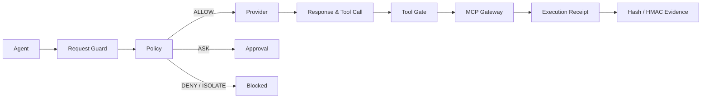

<div align="center">
  
  <h1>AgentBulwark · 智垒</h1>
  <p><strong>AI Agent Firewall</strong></p>
  <p>Put every model request, context input, output, and tool action behind an observable, enforceable, verifiable runtime boundary.</p>
  <p>
    <a href="https://github.com/Chengxiaoyu1119/AgentBulwark/actions/workflows/quality.yml"></a>
    <a href="https://github.com/Chengxiaoyu1119/AgentBulwark/blob/main/LICENSE"></a>
    <a href="https://www.python.org/"></a>
    <a href="https://nodejs.org/"></a>
    <a href="https://modelcontextprotocol.io/"></a>
  </p>
  <p>
    <a href="README.md">中文</a> ·
    <a href="docs/product/产品定位.md">Positioning</a> ·
    <a href="docs/engineering/安全边界.md">Security boundary</a> ·
    <a href="CONTRIBUTING.md">Contributing</a>
  </p>
</div>

> **In one line:** AgentBulwark is a local-first AI Agent Firewall. It keeps what the model intended and what the system actually executed on one traceable chain.

## Start here

| You want to                               | Start with                                                       |
| ----------------------------------------- | ---------------------------------------------------------------- |
| Run the firewall locally                  | [Quick start](#quick-start)                                      |
| Connect an OpenAI-compatible model or MCP | [Connect an Agent](#connect-an-agent)                            |
| Understand policy, approval, and evidence | [How one action is proven](#how-one-action-is-proven)            |
| Check project fit                         | [Use cases](#use-cases) and [Project status](#project-status)    |
| Contribute or report a security issue     | [Contributing](CONTRIBUTING.md) · [Security policy](SECURITY.md) |

## The enforcement path



## The problem it solves

An API gateway can decide whether a request reaches a service. A text filter can decide whether a string looks risky. AgentBulwark continues to **model output, tool arguments, and real execution**: policy decides the action, the MCP gate controls side effects, and receipts plus evidence record what actually happened.

| Protection layer | Observes                                        | Fail-closed outcome                |
| ---------------- | ----------------------------------------------- | ---------------------------------- |
| Request          | Prompts, external context, identity, session    | No Provider call                   |
| Model            | Output, tool definitions, normalized Tool Calls | No tool-gate handoff               |
| Action           | Agent, Session, Schema, target, approval        | `DENY` or `ISOLATE`                |
| Evidence         | Trace, hashes, HMAC, execution receipt          | Reject execution on evidence error |

## Capability matrix

- **OpenAI-compatible gateway**: streaming and non-streaming `/v1/chat/completions`; non-streaming `/v1/responses`.
- **MCP Gateway**: stdio and Streamable HTTP with Agent + Session isolation.
- **Policy gate**: tool registration, schema, target, permissions, and deny-first conflict handling.
- **One-time approvals**: bind argument hash, policy version, Agent, Session, target, and expiry; changes or replay invalidate the approval.
- **Verifiable receipts**: request/response hashes, an HMAC audit chain, and server-observed execution receipts reference one request chain.
- **Local console**: inspect live protection, events, settings, approvals, execution state, and evidence.

## How one action is proven

A real Tool Call goes through at least these steps:

1. The gateway assigns a chain identifier and hashes the request.
2. Request and external context checks run before the Provider; failure means no Provider call.
3. The Provider is reached through a fixed host, protocol, port, and path.
4. The model response is normalized; unknown tools, poisoned definitions, and malformed arguments cannot continue.
5. Policy returns `ALLOW`, `DENY`, `ASK`, or `ISOLATE`; approval binds the exact argument hash, identity, and expiry.
6. Only a registered tool that passes MCP session, schema, target, and permission checks can execute.
7. The server writes an execution receipt and links Trace, hashes, HMAC, and receipt into offline-verifiable evidence.

<details>
<summary>Redacted state example for an approval action</summary>

```json
{
  "decision": "ASK",
  "source_status": "correlated",
  "evidence_status": "pending",
  "next": "operator approval"
}
```

This illustrates state semantics, not a fixed API response. A source without cryptographic correlation can only be `correlated` or `unknown`.

</details>

## Use cases

| Team                 | Need                                                                | AgentBulwark entry point                        |
| -------------------- | ------------------------------------------------------------------- | ----------------------------------------------- |
| AI application team  | Internal tools need controlled permissions and visible side effects | Agent + Session + Tool Gate                     |
| MCP adopter          | Third-party server tools and targets can drift                      | Registration, schema, target, session isolation |
| Private-model team   | Credentials and requests must stay on the backend                   | Fixed Provider egress and backend credentials   |
| Security review team | Explain why an action was allowed or blocked                        | Trace, approval, receipt, offline evidence      |

## Quick start

Requirements: Node.js 22+ and Python 3.11+. This is a single-machine project; Docker is not required.

```powershell
git clone https://github.com/Chengxiaoyu1119/AgentBulwark.git
cd AgentBulwark
npm run install:all
Copy-Item .env.example .env
npm run dev
```

Open [http://127.0.0.1:8012](http://127.0.0.1:8012). The service listens on loopback by default; Provider keys and MCP credentials are read only by the backend.

### Check the local service

```powershell
Invoke-RestMethod http://127.0.0.1:8012/api/public/status
```

## Connect an Agent

Point the Agent's OpenAI Base URL to `http://127.0.0.1:8012/v1`, then register Provider and MCP settings in the backend environment. Core endpoints:

| Method | Path                      | Purpose                                   |
| ------ | ------------------------- | ----------------------------------------- |
| `POST` | `/v1/chat/completions`    | OpenAI Chat Completions                   |
| `POST` | `/v1/responses`           | OpenAI Responses (non-streaming)          |
| `POST` | `/api/mcp`                | MCP initialize, discovery, and tool calls |
| `GET`  | `/api/overview`           | Console overview data                     |
| `GET`  | `/api/approvals`          | Pending approvals                         |
| `GET`  | `/api/gateway/traces`     | Request and policy traces                 |
| `GET`  | `/api/runtime/executions` | Execution receipts                        |

## Quality gate

```powershell
npm run verify
npm run verify:live:fixture
```

`verify:live:fixture` runs a deterministic closure with the repository's real HTTP Provider and MCP stdio child process without rewriting operational data. `verify:live` does not contact external services by default; set `AGENT_SUPERVISOR_LIVE_SMOKE=true` explicitly for an external Provider smoke test.

## Console

The local console focuses on three operating tasks:

- **Protection**: service state, policy mode, and recent actions.
- **Events**: blocks, approvals, tool calls, and outcomes by request chain.
- **Settings**: Provider, MCP, Agent, session, and credential references.

## Project status

| Status                  | Scope                                                                                                             |
| ----------------------- | ----------------------------------------------------------------------------------------------------------------- |
| Implemented             | OpenAI/MCP gateways, four-state policy, one-time approvals, execution receipts, Hash/HMAC evidence, local console |
| In continued validation | External Provider/MCP compatibility, cross-platform packaging, real team pilots                                   |
| Explicitly out of scope | Attack lab, arbitrary code execution, Docker sandbox, DLP, multi-tenancy, Kubernetes                              |

The project does not treat internal fixtures, demo data, or model classifications as production closure evidence.

## Documentation map

| Entry                                                                     | Contents                                                  |
| ------------------------------------------------------------------------- | --------------------------------------------------------- |
| [Product positioning](docs/product/产品定位.md)                           | Users, capability boundaries, and trust language          |
| [Security boundary](docs/engineering/安全边界.md)                         | Runtime, policy, credential, and evidence constraints     |
| [Local development](docs/engineering/本地开发.md)                         | Installation, startup, configuration, and troubleshooting |
| [Research and decisions](docs/research/大模型防火墙研究证据与产品决策.md) | Product direction and technical rationale                 |
| [Contributing](CONTRIBUTING.md)                                           | Local development, verification, and pull requests        |
| [Security policy](SECURITY.md)                                            | Vulnerability reporting and sensitive issues              |
| [Agent guide](AGENTS.md)                                                  | Directory boundaries and engineering invariants           |

## Repository layout

```text
apps/api/agent_supervisor/  FastAPI service and runtime
apps/api/tests/             backend tests, fixtures, and closure checks
apps/console/               React + Vite console
docs/                       product, engineering, and research docs
legacy/                     read-only history, never a production import
scripts/                    startup, maintenance, and quality scripts
```

## Explicit boundaries

AgentBulwark is an AI Agent runtime firewall, not an attack lab, tool directory, arbitrary code executor, Docker sandbox, or multi-tenant platform. Text inspection covers request, context, and output checks; identity, policy, schema, and the MCP gate remain the execution boundary.

## License

Apache-2.0. See [LICENSE](LICENSE).
