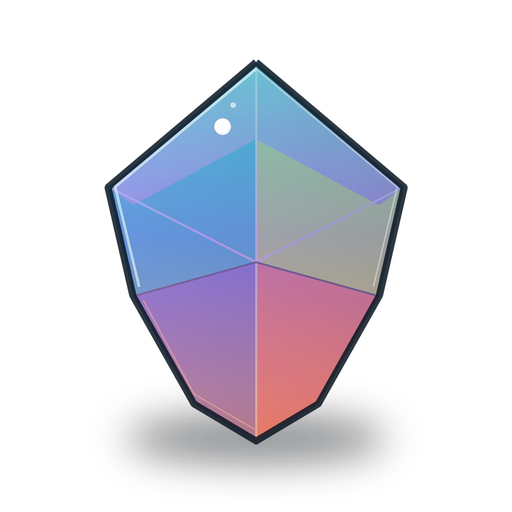
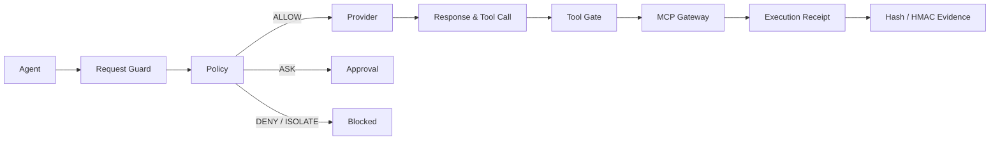

<div align="center">
  
  <h1>AgentBulwark · 智垒</h1>
  <p><strong>AI Agent Firewall</strong></p>
  <p>Put model requests, external context, outputs, and tool calls behind one observable, enforceable, verifiable runtime boundary.</p>
  <p>
    <a href="https://github.com/Chengxiaoyu1119/AgentBulwark/actions/workflows/quality.yml"></a>
    <a href="https://github.com/Chengxiaoyu1119/AgentBulwark/blob/main/LICENSE"></a>
    <a href="https://www.python.org/"></a>
    <a href="https://nodejs.org/"></a>
    <a href="https://modelcontextprotocol.io/"></a>
  </p>
  <p>
    <a href="README.md">中文</a> ·
    <a href="docs/product/产品定位.md">Positioning</a> ·
    <a href="docs/engineering/安全边界.md">Security boundary</a> ·
    <a href="CONTRIBUTING.md">Contributing</a>
  </p>
</div>

> **In one line:** AgentBulwark is a local-first AI Agent Firewall. Every model request and tool action passes policy before it reaches a real Provider or MCP server.

## The enforcement path



## Why it exists

An API gateway can decide whether a request reaches a service. AgentBulwark continues to the dangerous part: **model output, tool arguments, and real execution**. It keeps the model's intended action and the system's observed action on one traceable chain.

| Layer    | What it handles                                      | Outcome                               |
| -------- | ---------------------------------------------------- | ------------------------------------- |
| Request  | Prompts, external context, identity, and session     | Block risky input before the Provider |
| Model    | Output, tool definitions, and normalized Tool Calls  | Stop unknown or poisoned actions      |
| Action   | Agent, Session, Schema, target, policy, and approval | `ALLOW` · `DENY` · `ASK` · `ISOLATE`  |
| Evidence | Trace, hashes, HMAC, and execution receipt           | Verify the decision offline           |

## Capability matrix

- **OpenAI-compatible gateway**: streaming and non-streaming `/v1/chat/completions`; non-streaming `/v1/responses`.
- **MCP Gateway**: stdio and Streamable HTTP with Agent + Session isolation.
- **Policy gate**: tool registration, schema, target, permissions, and deny-first conflict handling.
- **One-time approvals**: bind argument hash, policy version, Agent, Session, target, and expiry.
- **Verifiable receipts**: request/response hashes, an HMAC audit chain, and server-observed execution receipts.
- **Local console**: live protection, events, settings, approvals, and evidence.

## Quick start

Requirements: Node.js 22+ and Python 3.11+. This is a single-machine project; Docker is not required.

```powershell
git clone https://github.com/Chengxiaoyu1119/AgentBulwark.git
cd AgentBulwark
npm run install:all
Copy-Item .env.example .env
npm run dev
```

Open [http://127.0.0.1:8012](http://127.0.0.1:8012). The service listens on loopback by default; Provider keys and MCP credentials are read only by the backend.

## Connect an Agent

Point the Agent's OpenAI Base URL to `http://127.0.0.1:8012/v1`, then register Provider and MCP settings in the backend environment. Core endpoints:

```text
POST /v1/chat/completions
POST /v1/responses
POST /api/mcp
GET  /api/overview
GET  /api/approvals
GET  /api/gateway/traces
GET  /api/runtime/executions
```

## Quality gate

```powershell
npm run verify
npm run verify:live:fixture
```

`verify:live:fixture` runs a deterministic closure with the repository's real HTTP Provider and MCP stdio child process without rewriting operational data. `verify:live` does not contact external services by default; set `AGENT_SUPERVISOR_LIVE_SMOKE=true` explicitly for an external Provider smoke test.

## Documentation map

| Entry                                                                     | Contents                                              |
| ------------------------------------------------------------------------- | ----------------------------------------------------- |
| [Product positioning](docs/product/产品定位.md)                           | Users, capability boundaries, and trust language      |
| [Security boundary](docs/engineering/安全边界.md)                         | Runtime, policy, credential, and evidence constraints |
| [Research and decisions](docs/research/大模型防火墙研究证据与产品决策.md) | Product direction and technical rationale             |
| [Contributing](CONTRIBUTING.md)                                           | Local development, verification, and pull requests    |
| [Security policy](SECURITY.md)                                            | Vulnerability reporting and sensitive issues          |
| [Agent guide](AGENTS.md)                                                  | Directory boundaries and engineering invariants       |

## Repository layout

```text
apps/api/agent_supervisor/  FastAPI service and runtime
apps/api/tests/             backend tests, fixtures, and closure checks
apps/console/               React + Vite console
docs/                       product, engineering, and research docs
legacy/                     read-only history, never a production import
scripts/                    startup, maintenance, and quality scripts
```

## Explicit boundaries

AgentBulwark is an AI Agent runtime firewall, not an attack lab, tool directory, arbitrary code executor, Docker sandbox, or multi-tenant platform. Text inspection covers request, context, and output checks; identity, policy, schema, and the MCP gate remain the execution boundary.

## License

Apache-2.0. See [LICENSE](LICENSE).
