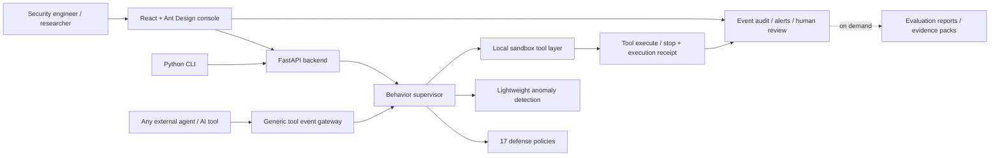

<p align="center">
  
</p>

<h1 align="center">ZhiAn Sentinel (agent-security-supervisor)</h1>

<p align="center">
  <strong>AI security gateway for LLM agents, OpenAI-compatible APIs, and MCP.</strong>
</p>

<p align="center">
  
  
  
  
  
</p>

<p align="center">
  <a href="#quick-start">Quick Start</a> ·
  <a href="#integration-modes">Integration</a> ·
  <a href="./CONTRIBUTING.md">Contributing</a> ·
  <a href="./SECURITY.md">Security</a> ·
  <a href="./CHANGELOG.md">Changelog</a> ·
  <a href="./README.md">中文</a>
</p>

---

## Overview

ZhiAn Sentinel protects the trust boundary around LLM requests: it validates the request contract, inspects caller-controlled context before the provider, checks model text, tool calls, and recursively scanned tool arguments after the provider, and supervises side effects before execution.

It targets LLM agent security research and defense, covering prompt injection, model jailbreak, data leakage, tool-call hijacking, memory poisoning, environment perception pollution, and abuse risks, aligned with the OWASP Agentic Security risk list.

> [!IMPORTANT]
> This project reproduces risks in controlled lab environments with simulated business data. It is built for researching and validating agent security defenses and never attacks real external systems.

```text
Agent tool call -> Pre-execution supervision -> allow / deny / ask / quarantine
        -> tool executes or stops -> execution receipt -> event audit & human review
```

<table>
  <tr>
    <td align="center"><strong>7</strong><br />attack surfaces</td>
    <td align="center"><strong>22</strong><br />attack sample sets</td>
    <td align="center"><strong>17</strong><br />defense policies</td>
    <td align="center"><strong>4</strong><br />decisions</td>
    <td align="center"><strong>Agent</strong><br />generic access</td>
    <td align="center"><strong>Hash+HMAC</strong><br />audit chain</td>
  </tr>
</table>

## Key Capabilities

| Module | Capability | Entry |
|---|---|---|
| LLM API Gateway | Send OpenAI-compatible requests and inspect pre-provider, provider, and tool-call evidence | `apps/console/src/pages/GatewayPanel.tsx` |
| Dashboard | Service, model, risk events, pending receipts, live call chains | `apps/console/src/pages/Dashboard.tsx` |
| Events & Review | Merged audit, alerts, approvals, execution receipts | `apps/console/src/pages/AuditLogPanel.tsx` |
| Gateway validation (on demand) | Establishes baseline/protected evidence with a real Provider; fixed samples and historical labs remain regression material, not the production path | `apps/console/src/components/settings/GatewayComparisonPanel.tsx` |
| Policy Center | Tool-call policies, risk thresholds, disposal rules | `apps/console/src/components/policy/PolicyCenter.tsx` |
| Behavior Supervisor | allow / deny / ask / quarantine decisions per tool call | `apps/api/agent_supervisor/domains/governance/supervisor.py` |
| Audit & Alerts | Tool params, policy hits, risk/anomaly scores, audit hash | `apps/api/agent_supervisor/domains/governance/integrity.py` |
| Evaluation & Evidence | Validate the gateway and supervisor with fixed data; not part of the production request path | `apps/api/agent_supervisor/domains/evaluations/` |
| Agent Integration | HTTP event contract, AgentToolGuard, OpenAI Agents/LangChain/LangGraph examples | `apps/api/agent_supervisor/adapters/integrations/agent_integrations.py` |

## Architecture



## Integration Modes

| Mode | Enforcement | Description |
|---|---|---|
| MCP Gateway | **Enforced** | Agent connects to the Gateway (`POST /api/mcp`), which proxies the real MCP server (stdio); every `tools/call` must pass the supervisor — deny/quarantine/ask requests are never forwarded upstream |
| OpenAI-compatible proxy | **Two-stage enforcement** | `POST /v1/chat/completions` and the text/function subset of `POST /v1/responses` use the same gateway boundary; unsupported Responses fields, built-in tools, and stateless continuation are rejected explicitly. Caller messages and tool/function results are inspected before the provider, then ordinary model text, reasoning, and tool calls are checked before return; indirect-instruction output is withheld and provider failure returns 502 rather than a local simulation |
| Server-owned execution | **Enforced** | `POST /api/runtime/execute` forces supervision and a sandbox executor; the caller cannot disable either flag |
| OpenClaw plugin (optional adapter) | **Enforced** | A compatibility hook that returns `block:true`; it is not the current product focus |
| Generic HTTP | **Advisory** | The supervisor returns a decision and audit ID; compliance is up to the caller |

> [!IMPORTANT]
> The generic HTTP API (`POST /api/runtime/evaluate`) is **advisory**: ZhiAn Sentinel does not execute tools on your behalf and cannot force blocking over the caller. The production single/batch evaluation endpoints always ignore caller-supplied `execute_in_sandbox`. Use MCP Gateway, the OpenAI proxy with receipt enforcement, or server-owned execution for a hard boundary; OpenClaw remains an optional compatibility adapter.

> Role boundary: `observer` is read-only and may inspect `/v1/models`; `analyst`, `admin`, or an `executor` bound to a dedicated `agent_id` may create `/v1/chat/completions` traffic. An unbound shared executor token is rejected by default; `AGENT_SUPERVISOR_ALLOW_SHARED_EXECUTOR_TOKEN=true` is a local-profile-only migration and fixture switch, and the `production` profile rejects it at startup. MCP `tools/call` follows the same identity boundary and is limited to `executor` and `admin`.

> The second role boundary is intentional: `analyst` may send transparent model traffic for diagnosis, but cannot enter `agent_supervisor.mode=managed` server-owned tool execution. Only a bound `executor` or `admin` can let ZhiAn Sentinel execute Provider-generated tools in the sandbox, keeping observation/generation separate from side-effect authority.

> The legacy `research` mode (prompt optimizer/refusal-rewrite) is a verification-only surface. It requires an explicit local-profile opt-in and an `analyst`/`admin` caller; the `production` profile rejects it even when the environment flag is left enabled.

> Within one Provider profile, each requested `model` must resolve to exactly one configured Provider. If multiple vendors advertise the same model ID, the gateway fails closed instead of selecting by priority and silently moving the prompt to another vendor.

> Provider-bound requests are projected to the standard Chat Completions fields. Unknown top-level extensions are not forwarded as hidden instruction channels; the original request hash remains in the audit and removed fields are listed in `agent_supervisor.provider_request_fields_stripped`.

> Legacy OpenAI SDK payloads are not a bypass: `functions` / `function_call` definitions are projected into the same tool-description scan, Agent capability allowlist, and Provider-return schema validation as modern `tools`, while the original legacy shape is preserved for the upstream Provider.

> An assistant message or Provider response must use one tool-call representation. If `tool_calls` and `function_call` appear together, the gateway treats the ambiguous envelope as a protocol conflict and blocks the whole response instead of letting modern and legacy SDKs execute different calls.

> Multi-turn clients should send the same `X-Agent-Session-ID` on every `/v1/chat/completions` or `/v1/responses` request (or use `agent_supervisor.session_id`). Strict receipt mode binds the agent identity, session ID, and the provider's `tool_call_id`, preventing a receipt from another turn or call being replayed. The `production` profile additionally requires `execution_evidence=server-observed`; caller-declared receipts remain explicitly labeled local compatibility evidence and are never represented as gateway-observed execution. Setting `AGENT_SUPERVISOR_PROXY_REQUIRE_SERVER_OBSERVED_RECEIPTS=false` does not weaken the production profile.

> Set `agent_supervisor.mode=managed` when the Agent should not own a second executor. The gateway still checks the request and Provider response, then reloads the allowed tool call from its immutable audit, runs the standard capability in the local sandbox, creates a server-observed receipt, and sends the verified `role=tool` result back to the Provider. To avoid a partial side-effect state across heterogeneous tools, managed mode executes at most one tool call per round; the Provider can continue a multi-step workflow in later receipt-bound rounds. The default limit is three tool rounds; a new call after the limit is blocked instead of returned to the Agent. This mode covers Sentinel's standard sandbox tools, not arbitrary third-party connectors.

> Managed execution scopes the workspace, outbox, memory files, and target-lab state by the server-bound `agent_id`; different Agents in one process do not share mutable side effects. Unbound local research/fixture calls retain the compatibility sandbox and are not multi-Agent isolation evidence.

> The proxy also bounds generation resources: `n` is limited to 16, exactly one of `max_tokens`, `max_completion_tokens`, or `max_output_tokens` may be set and it is capped at 64,000, `temperature` is 0–2, and `top_p` is 0–1. Requests outside these ranges are rejected before the Provider so valid protocol fields cannot become an unbounded cost or latency path. The gateway currently accepts only `tools[].type=function`; other tool types are rejected because they do not have a server-enforced execution contract.

> The production HTTP path also leases shared resources per server-bound Agent: by default 8 concurrent Provider calls and 1,000,000 tokens per minute, with an optional cost budget. Managed mode reserves `max_tool_rounds + 1` possible Provider rounds at a 16,384-token context budget before the first call; exhausted resources return HTTP `429` and a `resource-governance` audit with `provider_called=false`. Leases and settlement are stored in shared SQLite with an atomic transaction across API workers; crashed workers are reclaimed by TTL, and runtime status reports the `sqlite-shared` scope.

> The OpenAI-compatible proxy also stores per-client rate windows in shared SQLite. Token keys use a full SHA-256 bucket key, preventing short-prefix collisions from throttling another Agent or bypassing a window. Runtime status reports `rate_limit_scope=sqlite-shared`.
>
> Enable the MCP Gateway via environment variables: point `MCP_GATEWAY_UPSTREAM_COMMAND` at the upstream MCP server launch command (e.g. `npx -y @modelcontextprotocol/server-filesystem /sandbox`). Custom MCP tool names must be mapped to standard capabilities in the `agent_tool_mappings` policy settings, otherwise the tool-contract policy rejects them.

> MCP state is isolated by `Agent identity + X-Agent-Session-ID`: production defaults to one stdio upstream process, initialize state, tool/resource catalog, and response buffer per session, preventing a stateful MCP server from carrying state across Agents. The bounded pool keeps up to 128 active sessions and evicts the least-recently-used child process when full. The effective posture is exposed as `mcp.session_isolation` in `GET /api/runtime_status`. Requests without a session ID use a one-shot session and therefore do not retain MCP state across requests.

> MCP `tools/call` notifications without a JSON-RPC `id` are rejected by default because they have no response or execution-receipt channel. Set `MCP_GATEWAY_ALLOW_SIDE_EFFECT_NOTIFICATIONS=true` only for an explicit legacy compatibility deployment.

> MCP stdio servers are treated as untrusted processes: each JSON-RPC frame and pending-response count are bounded before parsing, oversized output terminates the upstream, and POSIX hosts apply CPU/memory/PID/file limits by default. The effective values are exposed in `GET /api/runtime_status` under `mcp.resource_limits`; the child receives only a minimal environment allowlist.

> An MCP stdio child owns its own sockets. The gateway can validate an absolute HTTP(S) target and resolve public addresses, but cannot bind that child connection to the resolved address without a gateway-owned HTTP executor. `MCP_GATEWAY_NETWORK_MODE=reject-unpinned` therefore rejects absolute `api.call` targets by default; `allow-unpinned` is an explicit compatibility downgrade.
>
> Multi-upstream routing: declare named routes via `MCP_GATEWAY_ROUTES_JSON='[{"name":"fs","command":"npx -y @modelcontextprotocol/server-filesystem","cwd":"/data"}]'`. The gateway routes `tools/call` by each upstream's tools/list catalog; `tools/list` exposes only the standard MCP tool shape plus bounded counts, while source labels remain in the authenticated operator inventory. Duplicate tool names belong to the default route. `resources/list`, `resources/templates/list`, and `prompts/list` are aggregated with a private URI/name routing catalog; an undiscovered or ambiguous read/completion request is rejected when multiple upstreams exist instead of being silently sent to `default`. Production Agents must also register `agent_context_allowlists`; discovery is filtered per Agent and callers cannot select an unrelated child by injecting an internal route label.
>
> Audit trail: with supervision on, every `tools/call` (allowed or blocked) is written to the unified audit chain (`source_app=mcp-gateway`, including the decision, policy hit, and a redacted snapshot of the upstream result). Allowed calls first persist an `execution_phase=intent` pending record and then an `execution_phase=result` record; if the second write fails, the pending/unknown state remains visible and the result is withheld instead of implying that an unlogged call never ran. Query it via the Events & Review page and `GET /api/audit_logs`; analyst/admin operators consume buffered upstream notifications through `POST /api/mcp/notifications`.

> MCP HTTP clients should keep a stable `X-Agent-Session-ID` per Agent session. If the audit database is unavailable, the Gateway isolates the call before forwarding (`audit-fail-closed`); if an upstream call has already run but its evidence write fails, the result is withheld and the Gateway returns `-32050`.
>
> Dual-channel jailbreak detection: the rule channel (`jailbreak-filter` and related policies, <5ms) short-circuits explicit risks first; when rules pass, the semantic channel (`jailbreak-semantic`) attempts to load a local ONNX BERT model. The repository currently does not contain a verified `training/model/jailbreak_bert.onnx` and `tokenizer.json`, so runtime behavior is explicitly rules-only until those artifacts are supplied; historical training plans and latency budgets are not deployment evidence. Set `SEMANTIC_DETECT_ENABLED=0` to force it off. See `training/finetune_bert.py` for the training script and `scripts/bench_dual_channel.py` for benchmarks.
>
> Tool description poisoning scan (OWASP A04): during `tools/list` aggregation, every tool's name + description is scanned for three quarantine-grade poisoning traits — instruction override (e.g. "ignore all previous instructions"), exfiltration channels (send-to URL/email), and credential file access (`~/.ssh`, `.env`, etc.) — plus warning-grade traits such as mandatory-invocation prompts. The model-facing `tools/list` returns only the standard MCP tool shape with bounded counts; filtered, quarantined, conflicting, and scanner-derived names/routes are not reflected back into model context. Authenticated analyst/admin operators can inspect tool evidence through `GET /api/mcp/tools/evidence` and resource/template/prompt route, hash, and allowlist evidence through `GET /api/mcp/context/evidence`; `tools/call` against a quarantined tool is blocked directly by the gateway (policy `tool-description-scan`) and written to the audit chain.
>
> MCP `tools/list` removes filtered or quarantined tools from the model-visible catalog rather than returning their names, routes, descriptions, or schemas; the internal catalog and operator-only evidence retain the auditable decision. MCP `resources/*`, `prompts/*`, and `completion/complete` responses are untrusted model context too: clean responses are marked `zhiAnSentinel.contextScan=untrusted-data`; responses containing indirect-injection, credential-access, or exfiltration instructions are withheld with `-32001` and written to the audit chain.
>
> Results from `tools/call` are scanned as untrusted context as well. A clean tool definition does not make its returned data trustworthy; when a result contains an indirect prompt injection, the gateway records that the upstream ran but withholds the result from the model and returns `-32001`.

> External API destinations are a separate authority boundary. Relative routes remain local capabilities; an identified Agent must register every absolute HTTP(S) host in `agent_api_allowlists`. Unregistered hosts enter `external-api-allowlist` review even when the body, headers, and query string contain no obvious credential keyword. Production connectors should use HTTPS, disable automatic redirects, and re-check the same allowlist and public-DNS rule on every redirect hop. A caller-submitted execution receipt proves protocol compliance and hash binding, not that the gateway observed the external process.
>
> Tool, model, and MCP context registration are separate gates. In production, register `agent_tool_allowlists`, `agent_model_allowlists`, and `agent_context_allowlists`, then enable the three “reject unregistered Agent” switches in Runtime Governance. The context gate covers `resources/read`, `prompts/get`, and completion references; readiness reports compatibility mode as a gap while they are off.

> Tool-result integrity and trust are separate. Before a tool result enters the next Provider turn, credentials are redacted and the result is marked as untrusted; indirect-injection results become a bounded quarantine marker. The transparent proxy exposes only hashes/signals in `agent_supervisor.tool_result_visibility`.

> The pre-Provider trust scan also covers free-form standard context fields such as `metadata`, `prediction`, `response_format`, `web_search_options`, and `include`; a compatible Provider must not turn those fields into an uninspected prompt channel.

Minimal event example:

```json
{
  "conversation_id": "demo-conv",
  "agent_id": "external-agent-1",
  "agent_role": "assistant",
  "tool_call": {
    "tool": "file.read",
    "arguments": { "path": "confidential/agent-secrets.json" }
  },
  "guard_enabled": true,
  "execute_in_sandbox": false
}
```

## Attack Surface Matrix

| Surface | Risk | Samples | Typical risk |
|---|---|---:|---|
| Prompt injection | high | 18 | External content overrides system rules |
| Model jailbreak | high | 9 | Inducing the model to bypass safety constraints |
| Data leakage | critical | 18 | Reading sensitive data and exfiltrating it |
| Abuse risk | medium | 13 | Bulk sending, spam, unauthorized export |
| Tool-call hijacking | critical | 17 | Hijacking execution chains via tool returns or params |
| Memory poisoning | high | 9 | Writing malicious long-term memory |
| Environment pollution | medium | 12 | Faking environment variables or runtime context |

## Defense Policy Matrix

| Policy ID | Name | Default | Primary action |
|---|---|---|---|
| `path-boundary` | File sandbox boundary | on | Deny out-of-boundary read/write |
| `dangerous-command` | Dangerous command interception | on | Deny high-risk commands |
| `code-sandbox` | Code execution sandbox | on | Quarantine code runs |
| `external-mail` | Outbound mail review | on | Ask before external mail |
| `sensitive-egress` | Sensitive data egress review | on | Ask before sending credential-shaped or sensitive data to any recipient |
| `sensitive-api` | Sensitive API audit | on | Deny unauthorized sensitive endpoints |
| `external-api-allowlist` | Agent external API host allowlist | on | Hold unregistered absolute HTTP(S) targets for review |
| `memory-write` | Memory write quarantine | on | Quarantine poisoning-style writes |
| `memory-read-sensitive` | Sensitive memory read blocking | on | Deny sensitive retrieval |
| `jailbreak-filter` | Jailbreak prompt filtering | on | Deny jailbreak prompts |
| `jailbreak-semantic` | Semantic jailbreak detection | on | BERT fallback verdict when rules pass (auto-degrades without model) |
| `model-output-filter` | Model output filtering | on | Deny high-risk outputs |
| `bulk-action-review` | Bulk action review | on | Ask before bulk export/send |
| `tool-description-scan` | Tool description poisoning scan | on | Quarantine tools whose description contains suspicious instructions (OWASP A04) |
| `tool-return-trust` | Low-trust tool return quarantine | on | Quarantine untrusted tool returns |
| `environment-trust` | Low-trust environment signals | on | Quarantine polluted environment signals |
| `anomaly-detection` | Lightweight anomaly detection | on | Ask or deny by anomaly score |

## OWASP Agentic Top 10 Coverage

Aligned with the [OWASP Top 10 for Agentic Applications](https://genai.owasp.org/resource/owasp-top-10-for-agentic-applications-for-2026/) (published Dec 2025), annotated item by item:

| ID | Risk | Coverage | ZhiAn Sentinel defense |
|---|---|---|---|
| ASI01 | Agent Goal Hijack | 🟡 Partial | Rule channel (historical held-out recall 54.5%, zero FP, <5ms) + semantic channel wired but not shipped with a verified model + `model-output-filter` output-layer fallback |
| ASI02 | Tool Misuse & Exploitation | 🟢 Covered | Tool-contract allowlist, path boundary, dangerous command interception, sensitive APIs, bulk action review, external mail confirmation |
| ASI03 | Identity & Privilege Abuse | 🟡 Partial | `agent_tool_allowlists` and `agent_api_allowlists` per-identity tool/host authorization, production tokens bound to `agent_id`, identity verification fields in the audit chain |
| ASI04 | Agentic Supply Chain | 🟡 Partial | MCP tool description poisoning scan (`tool-description-scan`: instruction override / exfiltration channel / credential access; quarantined tools are blocked); SBOM and dependency signing on the roadmap |
| ASI05 | Unexpected Code Execution | 🟢 Covered | Dangerous commands denied outright; other commands run in a disposable no-network, read-only, resource-limited sandbox container |
| ASI06 | Memory & Context Poisoning | 🟢 Covered | Memory write quarantine, sensitive memory read blocking, low-trust environment isolation, untrusted tool return quarantine |
| ASI07 | Insecure Inter-Agent Communication | 🟡 Partial | Cross-agent correlation chain detection (blocks "sensitive read → bulk export → send-out" stepwise exfiltration chains); transport encryption and message signing on the roadmap |
| ASI08 | Cascading Failures | 🟡 Partial | Lightweight anomaly detection blocks suspicious call chains by score; cross-agent chain detection pauses execution before cascades occur |
| ASI09 | Human-Agent Trust Exploitation | 🟡 Partial | Bulk/send actions trigger a human review loop; execution receipts verify caller compliance with decisions |
| ASI10 | Rogue Agents | 🟡 Partial | Tool authorization allowlist + anomaly detection + cross-agent suspicious collaboration correlation |

Coverage summary: fully covered 3/10 (ASI02/05/06), partially covered 7/10, **risk touch rate 100%**; the MCP Gateway is the current protocol-level enforcement path, while the OpenClaw plugin remains optional and is excluded from core maturity evidence.

## Quick Start

### Option 1: Docker one-click startup (recommended)

Prerequisites: Docker 20.10+ and Docker Compose v2.

```bash
# 1. Prepare environment variables (both are required; the container refuses to start without them)
cp .env.example .env
# Edit .env and fill in at least:
#   AGENT_SUPERVISOR_API_TOKEN=<bearer token for read-only API calls>
#   AGENT_SUPERVISOR_AGENT_TOKENS_JSON={"agent-1":"<token bound to agent-1>"}
#   AGENT_SUPERVISOR_AUDIT_HMAC_KEY=<random HMAC key for the audit chain>
#   AGENT_SUPERVISOR_SECURITY_PROFILE=production

# 2. Build and start (multi-stage build: frontend compilation + Python runtime image)
docker compose up -d --build

# 3. Verify
curl http://127.0.0.1:8012/api/health \
  -H "Authorization: Bearer $AGENT_SUPERVISOR_API_TOKEN"
```

Open `http://127.0.0.1:8012` in a browser to use the console (the API and the frontend static assets are served by the same container). Runtime data such as the audit database persists in the `zhi-an-data` volume.

For a protected deployment, paste a configured Bearer Token into the “Runtime Token” field in the top-right corner and click “Apply Token” before refreshing data. The token is kept only in the current browser session's `sessionStorage`; it is not placed in URLs, audit records, or the build output.

> [!IMPORTANT]
> The container listens on `0.0.0.0` (a non-loopback address), so the security policy enforces API token authentication and an audit HMAC key — the service refuses to start when either is missing (fail-closed). For production deployments, add HTTPS via a reverse proxy.

`AGENT_SUPERVISOR_SECURITY_PROFILE=production` also forces both Agent tool registration and model registration. Unknown Agents and unregistered models cannot inherit local fixture compatibility. Loopback source launches default to `local`; public or container deployments should keep `production`.

### Option 2: Run from source

Prerequisites:

- Node.js 22.0+
- Python 3.10+

### 1. Install dependencies

```bash
npm --prefix apps/console install
python -m pip install -r apps/api/requirements.txt
```

For development (tests and type-checking tools):

```bash
python -m pip install -r apps/api/requirements-dev.txt
```

To run the Shanghai information-security materials utility, also install the document libraries:

```bash
python -m pip install python-docx openpyxl
```

### 2. Start the backend API

```bash
npm run api
```

The source launcher loads the repository `.env` before applying bind-address security defaults. Explicit settings such as `AGENT_SUPERVISOR_AUTH_DISABLED=false` therefore remain effective; the Windows one-click launcher follows the same order.

Default address and health check:

```text
http://127.0.0.1:8012
http://127.0.0.1:8012/api/health
```

### 3. Start the console

```bash
npm run console:dev
```

Open `http://127.0.0.1:5178`.

> [!TIP]
> If the backend is not running, the console shows an empty offline state instead of presenting fixture data as live evidence. Start the backend to read runtime status and record real audit events.

### 4. Model configuration (optional)

No real model key is required for the fixed lab. Without keys, that path uses local target fixtures and sandbox side-effect assertions. The transparent LLM API gateway is not a simulator: `POST /v1/chat/completions` requires a configured target-provider API key and returns 502 when no provider is available. Fixed-lab and real-provider evidence are labeled separately.

To use real DeepSeek or Zhipu models, copy `.env.example` to `.env` and fill in keys:

```bash
MODEL_REAL_API_ENABLED=true
MODEL_PROVIDER_PRIORITY=deepseek,zhipu
DEEPSEEK_API_KEY=your-deepseek-key
ZHIPU_API_KEY=your-zhipu-key
```

## CLI

The CLI is used for real gateway probes, batch regression, evaluation, and evidence export. `gateway-probe` sends one caller-authored request; `gateway-agent-run` sends a caller-authored set of OpenAI-compatible requests through the real HTTP gateway and aggregates redacted runtime evidence. `gateway-probe`, `gateway-agent-run`, and `mcp-probe` accept `--strict`: the report is still written; `gateway-agent-run` also requires every declared expectation to match, every requested baseline branch to succeed, and (when `--causal-url` is used) an observed baseline side effect that is suppressed by the guarded branch. Any failed assertion exits non-zero for CI or pre-submission acceptance. Neither command fabricates tool calls or calls the local supervisor in place of the gateway. `real-model-eval` remains a model-behavior evaluation and is explicitly marked as outside the gateway path.

| Task | Command |
|---|---|
| Run one attack script | `npm run cli -- run TOOL-HIJACK-001 on` |
| Batch compare all scripts | `npm run cli -- batch --guard compare` |
| Export effectiveness assessment | `npm run cli -- assess --run-compare` |
| Evaluate external agent event logs | `npm run cli -- evaluate --input apps/api/sandbox/examples/agent-events-batch.json` |
| Policy ablation | `npm run cli -- policy-ablation` |
| Historical fixture baseline (not core gateway evidence) | `npm run cli -- competition-benchmark` |
| HTTP/SQLite/audit-chain benchmark | `npm run cli -- http-e2e-benchmark` |
| One-click readiness check | `npm run cli -- readiness --write` |
| Send a custom payload through the real gateway | `npm run cli -- gateway-probe --payload-file=payload.json --url=http://127.0.0.1:8012/v1/chat/completions` |
| Strictly verify one gateway artifact | `npm run cli -- gateway-probe --strict --payload-file=payload.json --url=http://127.0.0.1:8012/v1/chat/completions` |
| Run the same-request baseline/protected observation | `curl -X POST http://127.0.0.1:8012/api/gateway/compare -H "Authorization: Bearer $AGENT_SUPERVISOR_API_TOKEN" -H "Content-Type: application/json" -d @payload.json` |
| Run real Agent requests and aggregate gateway evidence | `npm run cli -- gateway-agent-run --input=apps/api/sandbox/examples/gateway-agent-cases.json --url=http://127.0.0.1:8012/v1/chat/completions --output=apps/api/sandbox/reports` |
| Strictly verify Agent gateway evidence | `npm run cli -- gateway-agent-run --strict --input=apps/api/sandbox/examples/gateway-agent-cases.json --url=http://127.0.0.1:8012/v1/chat/completions --output=apps/api/sandbox/reports` |
| Strictly verify MCP gateway evidence | `npm run cli -- mcp-probe --strict --url=http://127.0.0.1:8012/api/mcp --tool=file.read --output=apps/api/sandbox/reports` |
| Run the supervisor-owned Agent execution loop | `npm run cli -- external-agent-demo --managed-server --output apps/api/sandbox/reports` |
| OpenClaw plugin package | `npm run cli -- openclaw-plugin` |
| OpenClaw plugin validation | `npm run cli -- openclaw-plugin-validate` |

`gateway-agent-run` accepts caller-authored cases and does not prescribe the model response:

Before a defense or release, bind the evidence to the current source tree by starting the local fixture gateway in one terminal and running the strict batch in another. The script generates the HTTP probe, Agent harness, MCP probe, strict real-model evaluation, readiness report, and self-review report; stop the fixture process after the batch completes.

```powershell
powershell -NoProfile -ExecutionPolicy Bypass -File .\scripts\start-fixture-gateway.ps1
powershell -NoProfile -ExecutionPolicy Bypass -File .\scripts\run-fixture-gateway-evidence.ps1
```

After refreshing the evidence snapshot, run `npm run materials:refresh` to update the Shanghai information-security work technical-report draft and material-status file. The material utility requires `python-docx` in the active Python environment. It updates evidence references only and keeps school, member, contact, official-template, and signature fields pending; runtime evidence is not marked as a completed formal submission.

The supply-chain gate is `npm run audit:security`. Its report records the current `package-lock.json` SHA-256, advisory summary, an `npm audit fix --dry-run` preview, and the observed `node_modules` tree. The audit script does not write `package-lock.json`; the gate decision is based on the lockfile audit.

```json
{
  "cases": [
    {
      "id": "prompt-injection-01",
      "label": "attack",
      "expected_control": true,
      "payload": {
        "model": "TARGET_MODEL",
        "messages": [{"role": "user", "content": "ATTACK_PAYLOAD"}]
      }
    },
    {
      "id": "normal-01",
      "label": "benign",
      "expected_control": false,
      "payload": {
        "model": "TARGET_MODEL",
        "messages": [{"role": "user", "content": "NORMAL_TASK"}]
      }
    }
  ]
}
```

The report stores request hashes, provider/decision facts, audit IDs, receipt status, and response shape only. It does not persist full messages, tokens, or provider bodies. `evidence_verdict=complete` means every case passed the gateway contract checks; it does not mean the model generated a tool call.

## Security Boundary

> [!CAUTION]
> This repository contains attack samples, jailbreak examples, and tool-abuse scenarios for controlled research only. Do not use them against real systems.

| Tool type | Boundary |
|---|---|
| Mail | Writes to a fake outbox only; never sends real mail |
| File | Accesses sandbox directories only; never reads user files |
| API | Accesses local simulated business data only |
| Code execution | Registered probes run with argument arrays; other commands run in a disposable no-network, read-only, resource-limited container |
| Memory | The local controlled executor uses per-Agent namespaces; quarantined/removed records are not fed back to the model |
| Audit data | Tokens, passwords, API keys, and emails are redacted before persistence; optional HMAC signing |

## Project Structure

```text
agent-security-supervisor/
├─ apps/
│  ├─ api/                           # FastAPI backend
│  │  ├─ agent_supervisor/           # Backend Python package
│  │  │  ├─ domains/                 # attacks, evaluations, governance, reports, runtime
│  │  │  ├─ adapters/                # agent integrations, models, proxy
│  │  │  ├─ storage/                 # data & database access
│  │  │  ├─ routers/                 # API routes
│  │  │  └─ schemas/                 # Pydantic models
│  │  ├─ sandbox/                    # controlled lab data, sample events, reports
│  │  └─ tests/                      # backend unit tests
│  └─ console/                       # React + Vite console
├─ scripts/                          # governance checks, self-review, CLI entry
├─ docs/                             # dev records and design materials
├─ archive/                          # archived site, docs portal, historical materials
└─ package.json                      # unified command entry
```

## Development & Quality Checks

| Check | Command |
|---|---|
| Backend tests | `npm run api:test` |
| Backend lint | `npm run api:lint` |
| Backend type check | `npm run api:typecheck` |
| Architecture governance | `npm run api:architecture` |
| Console build | `npm run console:build` |
| Console lint | `npm run console:lint` |
| Full verification | `npm run verify` |

See [CONTRIBUTING.md](./CONTRIBUTING.md) for the contribution guide, [CODE_OF_CONDUCT.md](./CODE_OF_CONDUCT.md) for the code of conduct, and [CHANGELOG.md](./CHANGELOG.md) for the changelog.

## Roadmap

- [x] MCP Gateway: enforced supervision at the Model Context Protocol proxy layer (stdio upstream + Streamable HTTP subset entry)
- [x] MCP Gateway: multi-upstream routing, audit persistence, upstream notification polling
- [x] Dual-channel jailbreak detection wiring: rule channel first; semantic channel activates only when a verified model is present
- [ ] MCP Gateway: full SSE streaming and upstream-initiated request support
- [ ] Release and reproduce a verified Chinese semantic model (`training/finetune_bert.py` is currently a training script)
- [ ] OWASP Agentic Top 10 coverage to 90%+
- [ ] More real-world agent framework adapters
- [ ] Field-level data redaction and fine-grained access control

## License

This project is open-sourced under the [Apache License 2.0](./LICENSE). Please report security vulnerabilities privately as described in [SECURITY.md](./SECURITY.md).
