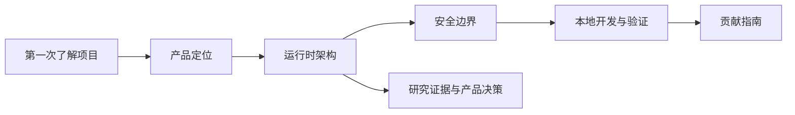

# 文档中心

这里是 GitHub 中面向读者的产品、工程、架构与研究文档。它们解释当前实现的边界，不是运行时策略、生产数据或配置来源。



## 按角色阅读

| 你是谁 | 建议顺序 | 目的 |
| --- | --- | --- |
| 产品、安全或技术负责人 | [产品定位](product/产品定位.md) → [安全边界](engineering/安全边界.md) → [研究与决策](research/大模型防火墙研究证据与产品决策.md) | 明确系统解决的问题、信任口径和未覆盖范围 |
| Agent / 后端接入工程师 | [运行时架构](architecture/运行时架构.md) → [本地开发](engineering/本地开发.md) | 了解请求链路、接口入口、执行模式和验证方式 |
| 控制台或运维工程师 | [运行时架构](architecture/运行时架构.md) → [安全边界](engineering/安全边界.md) → [本地开发](engineering/本地开发.md) | 识别运行数据、权限和证据状态的真实含义 |
| 贡献者 | [协作指南](../AGENTS.md) → [本地开发](engineering/本地开发.md) | 按仓库规则提交局部、可验证的改动 |

## 文档地图

| 目录 | 内容 | 维护规则 |
| --- | --- | --- |
| `product/` | 用户、问题定义、能力边界与可信度口径 | 只写当前产品事实和明确非目标 |
| `architecture/` | 组件、请求链路、数据与执行边界 | 以源码、路由和测试契约为准 |
| `engineering/` | 安全约束、本地安装、启动、验证与运行数据管理 | 命令必须可在当前仓库执行 |
| `research/` | 当前产品决策使用的外部研究证据 | 区分论文事实、工程推论和未证明结论 |

## 文档与仓库的边界

| 内容 | 位置 | 是否进入 Git | 说明 |
| --- | --- | --- | --- |
| GitHub 项目说明 | 根目录 `README.md` 与本目录 | 是 | 面向仓库访问者的稳定入口 |
| 文档站源码 | `apps/docs/` | 是 | 单独由 Docusaurus 构建 |
| 本地研究材料 | `docs/training/` | 否 | 被忽略，不参与构建、运行或质量门禁 |
| 运行和质量数据 | `apps/api/runtime/` | 否 | 不应复制进文档或提交到仓库 |
| 设计与研究素材 | 不以 `docs/media/` 作为现有约定 | 不适用 | 当前仓库没有受版本控制的 `docs/media/` 目录 |

根目录 [README](../README.md)、[package.json](../package.json)、[AGENTS.md](../AGENTS.md) 和实际 `apps/` 源码共同构成当前可执行事实。文档描述与代码、测试冲突时，应先核实再修改，不能仅以文档为准。

## 文档质量检查

```powershell
# 构建 Docusaurus 文档站
npm run docs:build

# 检查 GitHub 文档链接、Mermaid 围栏和命令引用
npm run docs:check
```

`docs:check` 只检查 GitHub Markdown 文档，不运行外部 Provider，也不写入运行数据。提交前仍需按改动范围执行 [协作指南](../AGENTS.md) 中的质量门禁。
