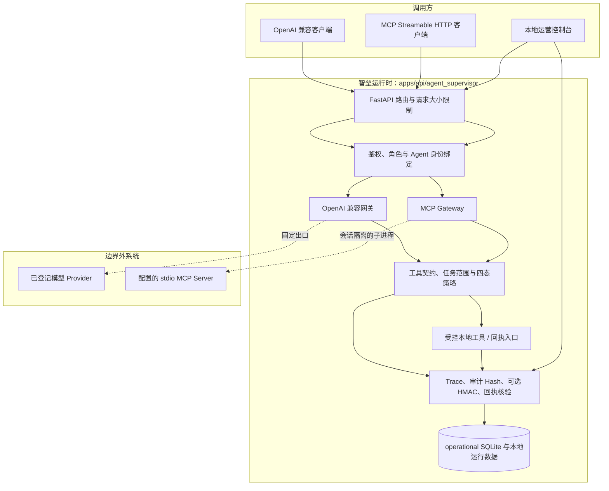
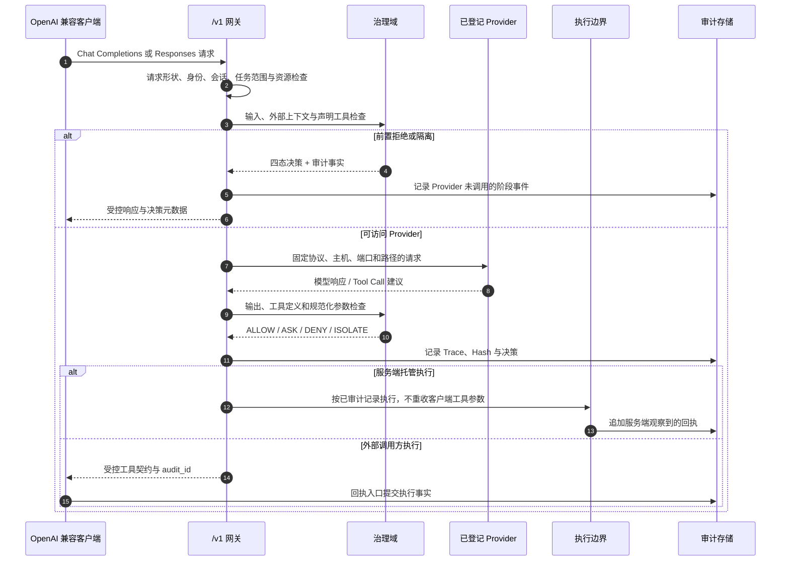
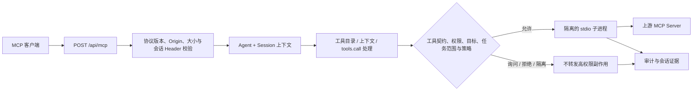
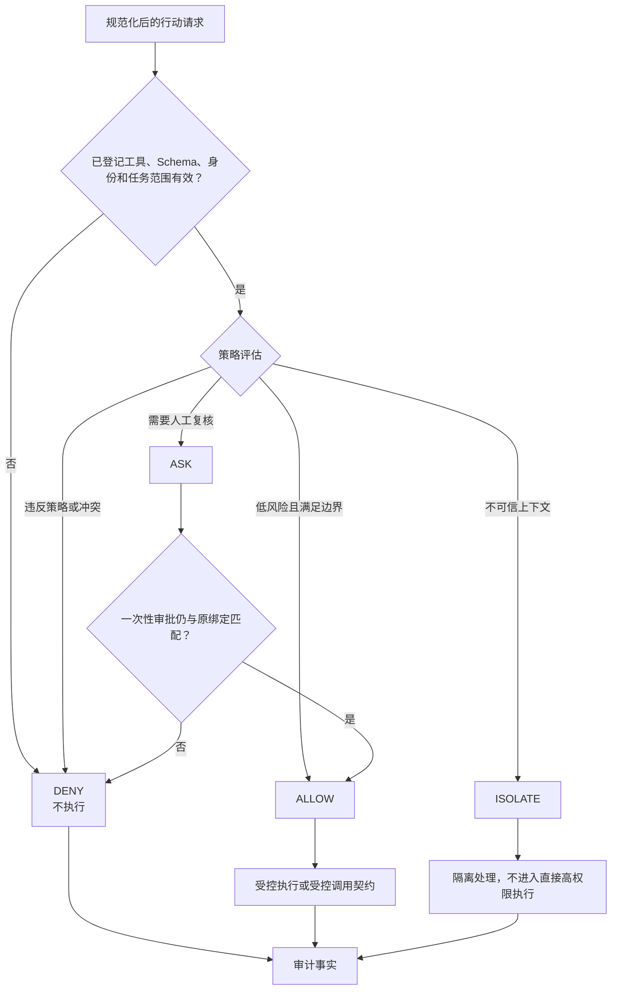
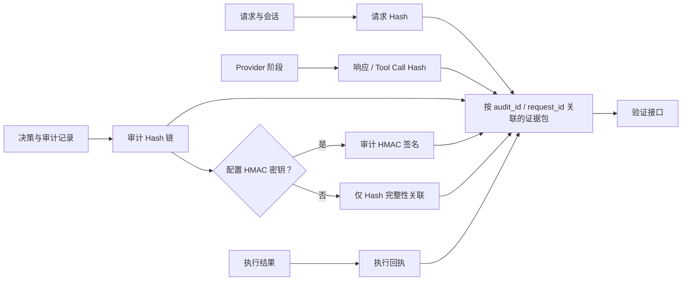

# 运行时架构

> **阅读目标**：说明一条请求从进入智垒到产生审计事实的真实边界。本文描述当前仓库实现，不把规划中的部署形态或研究结论写成已交付能力。

## 架构摘要

AgentBulwark 是单机优先的 FastAPI 运行时网关。它将 OpenAI 兼容请求和 MCP 工具调用引向不同的协议入口，但两条链路都会落入身份、会话、策略、执行和证据约束。

### 组件职责

| 组件 | 仓库位置 | 负责什么 | 不负责什么 |
| --- | --- | --- | --- |
| HTTP 与启动 | `apps/api/agent_supervisor/main.py`、`apps/api/dev_server.py` | 路由装配、CORS、请求体限制、静态控制台托管 | 业务策略本身 |
| OpenAI 网关 | `routers/proxy.py`、`adapters/proxy/` | `/v1/chat/completions`、`/v1/responses`、请求/输出/Tool Call 检查 | 让客户端绕过执行边界 |
| MCP Gateway | `routers/mcp.py`、`mcp_gateway/` | Streamable HTTP、stdio 上游、会话隔离、协议兼容与工具控制 | 把不受控上游当作可信运行时 |
| 治理域 | `domains/governance/` | 策略、工具契约、审批、任务范围、脱敏与完整性 | 用模型分类结果替代确定性授权 |
| 运行时执行 | `domains/runtime/` | 受限本地工具、执行回执、运行状态和事件 | 任意宿主机命令执行 |
| 证据与存储 | `domains/evidence/`、`storage/` | 审计链、Trace、回执关联和验证 | 将相关性伪装为来源证明 |

## 请求链路

### OpenAI 兼容路径

`transparent` 是默认网关模式：网关转发模型请求，并在暴露 Tool Call 前执行检查。`managed` 模式只允许具备相应身份的调用方使用，执行受仓库内受限运行时约束。两种模式都不接受“客户端重传一份工具参数”来替代已审计调用。

### MCP 路径

MCP Gateway 只有在配置 `MCP_GATEWAY_UPSTREAM_COMMAND` 且未显式禁用后才会启用。默认会话隔离按 Agent + Session 分配子进程；未配置上游时，控制台与其他 API 可以启动，但 MCP 工具服务不可用。

## 决策与执行边界

| 决策 | 可做的事 | 不能做的事 |
| --- | --- | --- |
| `ALLOW` | 进入受控执行流程或返回可关联的调用契约 | 以未审计的参数替换原调用 |
| `ASK` | 创建可复核的一次性审批 | 在审批前产生工具副作用 |
| `DENY` | 写入拒绝证据 | 转发到工具执行器 |
| `ISOLATE` | 将低信任数据留在隔离处理路径 | 直接进入高权限执行路径 |

## 身份、部署与网络

| 情况 | 默认行为 | 依据 |
| --- | --- | --- |
| 本地启动 | 监听 `127.0.0.1`，本地启动器设置免登录 | `scripts/启动智安哨.ps1` |
| 非回环或 production 档 | 要求关闭免登录，并配置 Token 与审计 HMAC 密钥 | `domains/runtime/server_security.py` |
| Provider 出口 | 由后端配置，不把凭证发送到浏览器；禁止自动重定向 | `adapters/models/model_adapter.py` |
| MCP 网络目标 | 默认拒绝无法由网关固定地址的上游网络动作 | `mcp_gateway/config.py` |
| 子进程环境 | MCP 子进程不继承 Provider 或 Supervisor 敏感变量 | `mcp_gateway/upstream.py` 的回归契约 |

这里的“生产档”是应用内运行配置，不等同于完成公网部署审计。公网绑定、反向代理、TLS、密钥轮换和宿主机隔离需要由实际部署环境额外完成。

## 证据语义

- `Hash` 用于固定内容与关联链路；它本身不代表来源身份已经被密码学证明。
- 配置 `AGENT_SUPERVISOR_AUDIT_HMAC_KEY` 后，审计记录会产生 HMAC 签名；验证时会检查签名存在性和匹配性。
- 执行回执区分调用方声明与服务端观察到的执行。透明网关对服务端托管执行会从已存审计记录读取参数，而不是信任客户端重复提交。
- 来源状态只能写为 `proved`、`correlated` 或 `unknown`。`correlated` 说明关联成立，不等同于 `proved`。

## 数据与目录边界

| 数据 | 路径 | 生命周期 | Git 状态 |
| --- | --- | --- | --- |
| 运营状态、策略、审批和审计 | `apps/api/runtime/operational/` | 正式本地运行数据 | 忽略，不能由清理脚本删除 |
| 质量报告、缓存和闭环产物 | `apps/api/runtime/quality/` | 可重建 | 忽略，可按规则清理 |
| 浏览器 E2E 数据 | `apps/api/runtime/e2e/` | 可重建 | 忽略 |
| 显式创建的备份 | `apps/api/runtime/backups/` | 由备份命令管理 | 忽略，不作缓存清理 |
| 回归 fixture | `apps/api/tests/fixtures/` | 随源码版本演进 | 提交 |

运行数据不能作为文档示例、fixture 或提交内容。清理命令、备份命令和验证范围见 [本地开发](../engineering/本地开发.md)。

## 接口地图

| 领域 | 主入口 | 用途 |
| --- | --- | --- |
| 健康与会话 | `GET /api/public/status`、`GET /api/auth/context` | 本地就绪与当前权限上下文 |
| 模型网关 | `POST /v1/chat/completions`、`POST /v1/responses` | OpenAI 兼容请求 |
| MCP | `POST /api/mcp`、`GET /api/mcp/info` | Streamable HTTP 请求与能力状态 |
| 运行时态势 | `GET /api/observability/overview`、`GET /api/events/stream` | 正式控制台数据与事件流 |
| 审批与执行 | `GET /api/approvals`、`POST /api/runtime/executions/{audit_id}/complete` | 人工复核与外部执行回执 |
| 证据 | `GET /api/evidence/{evidence_id}`、`POST /api/evidence/{evidence_id}/verify` | 脱敏证据与完整性核验 |

接口的鉴权、角色和参数契约以运行中的 API 与对应测试为准。`/api/overview` 是保留兼容接口，不是新控制台的运行态势数据源。
